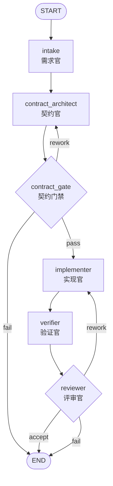

# Architecture.md — 我对 LangGraph 编排架构的理解

> 交付对象：HexaGraph 负责人（Issue #4）。
> 本文不是转述官方文档，而是我读完 LangGraph 之后形成的模型，并且已经在
> `orchestration/` 里把它跑成了可执行的东西；文中每个「本仓库证据」都能在代码里查到。

---

## 1. 一句话结论

**LangGraph 不是「把函数串起来」，而是把一次业务流程建模成一台显式的状态机**：
State 是唯一真相，Node 是只读状态、只写增量的纯函数，Edge 决定下一步去哪，
编译之后由运行时按「超级步（super-step）」循环推进，直到没有可执行节点。

这个模型的价值在于：流程不再藏在 `if/else` 和函数调用的调用栈里，而是**变成一张可以被画出、被持久化、被打断、被回放的图**。

---

## 2. 三层结构：定义 → 编译 → 执行

| 层 | 你写的东西 | 它解决什么 |
| --- | --- | --- |
| **定义层** | `StateGraph(State)` + `add_node` + `add_edge` | 声明「有哪些角色、状态长什么样、谁接谁」 |
| **编译层** | `graph.compile(checkpointer=...)` | 校验图结构（有没有孤立节点、有没有入口），产出可执行对象 |
| **执行层** | `invoke / stream` | 按超级步推进，每步结束落一次快照 |

关键点：**定义层描述的是「可能的路」，执行层走的是「这一次的路」**。同一个图，输入不同，走的路径可以完全不同——本仓库里 `contract_gate` 第一轮打回、第二轮通过，就是这个差别。

**本仓库证据**：`orchestration/graph.py:50` 的 `build_graph()` 完成定义 + 编译；`graph.py:67` 之后的三段 `add_conditional_edges` 声明了可能的路。

---

## 3. State：两种截然不同的写回语义

这是最容易踩坑、也最能体现 LangGraph 设计意图的地方。

| 语义 | 写法 | 行为 |
| --- | --- | --- |
| **覆盖（LastValue）** | 普通字段声明 | 后写的值直接替换旧值 |
| **归约（Reducer）** | `Annotated[list, operator.add]` | 新值与旧值按 reducer 合并 |

**为什么必须分清**：如果 `trace`（审计轨迹）用覆盖语义，那么每个节点一执行就会把前面所有轨迹冲掉——你会得到一条永远只有 1 条的日志，看上去「跑通了」，实际上什么都没留下。反过来，如果 `verdict`（最终结论）用归约语义，那么「打回」和「通过」会同时存在于状态里，评审结论就失去了唯一性。

所以本仓库的取舍是明确的：

- `trace` 用 `operator.add` 归约 —— 因为它是**事件流**，天然可累积（`state.py:57`）；
- 其余字段全部覆盖 —— 因为每一轮都代表一次**完整重算**，旧值不应残留（`state.py:26-58`）。

一句话记住：**「历史上发生过什么」用归约，「现在是什么」用覆盖。**

---

## 4. 编排怎么走：超级步、条件边、环

### 4.1 超级步（super-step）

运行时不是「一个节点一个节点地爬」，而是分轮推进：

```
第 k 步：找出所有「入边已满足」的节点 → 并行执行 → 收集各自返回的增量
        → 按 reducer 合并进 State → 落一次 checkpoint → 进入第 k+1 步
直到没有任何可执行节点，或走到 END
```

这解释了三个常见现象：

1. **同一超级步内的节点看不到彼此的写入**——它们读的都是步初的快照；
2. **并行是默认能力**，不需要你写线程池，只要从同一个节点连出多条边；
3. **环是合法的**，因为「下一轮用什么状态」由 State 决定，而不是靠递归调用栈。

### 4.2 条件边：把 if/else 提升为图的一等公民

条件边 = 一个纯函数 `state -> 分支名`，分支名再映射到目标节点。它比 `if/else` 强在两点：

- 路由逻辑**可以被单独测试**（不用把整条链路跑起来）；
- 路由决策**留在 State 里可追溯**，而不是消失在调用栈里。

**本仓库证据**：`route_after_gate`（`graph.py:32`）与 `route_after_review`（`graph.py:41`）都是纯函数，单测里直接断言六种输入的返回值（`test_graph.py:test_router_unit_paths`）。

### 4.3 环必须有上限

条件边能造环，环能造死循环。LangGraph 自身有 `recursion_limit`（默认 25 个超级步）作为兜底，但那是**最后一道保险，不是设计**。

真正的设计是：**每个环都要有业务意义上的退出条件**。本仓库给了两个：

- 契约门禁最多 3 轮（`MAX_GATE_ROUNDS`，`graph.py:25`）
- 评审最多 2 轮（`MAX_REVIEW_ROUNDS`，`graph.py:26`）

超过上限就走 `fail` 到 END，让「没通过」成为一个**明确的结果**，而不是进程卡死。

---

## 5. 三条让图变成「工程」而不是「demo」的能力

### 5.1 Checkpointer：状态可持久化、可回放

编译时传入 checkpointer，运行时的每次超级步结束都会落一份快照，按 `thread_id` 归档。由此解锁：

- **断点续跑**：进程崩了，同一 `thread_id` 能接着走；
- **时间旅行**：回到任意历史步重新分叉；
- **人工介入**：配合 `interrupt` 在某个节点前暂停，等人点头再继续。

**本仓库证据**：`build_graph()` 默认挂 `MemorySaver`，`test_checkpoint_persists_final_state` 用同一 `thread_id` 调 `get_state()` 取回终态。

**边界**：`MemorySaver` 只活在进程内，进程退出即丢。生产要换 SQLite/Postgres checkpointer——本 demo 没做，属于已知未验证范围。

### 5.2 Interrupt：人在环里（HITL）

编排不是「全自动才高级」。真正危险的动作（改生产库、发通知、花钱）应该允许在图上设闸门。LangGraph 的做法是：在节点内 `interrupt()` 暂停，状态被 checkpoint 保存，人处理完再 `Command(resume=...)` 继续。

这和本仓库的「契约门禁」是同一个思想的两个层次：**门禁是自动闸门，interrupt 是人工闸门**。

### 5.3 子图：把图当节点用

编译后的图本身可以作为另一个图的节点。这意味着复杂系统可以分层：每个子团队内部是一张图，对外只暴露「入 State → 出增量」。

本仓库规模小（6 个节点）没有拆子图；但 HexaGraph 的「6 人编排」一旦演化成每人一张子图，就需要这一层——**这也是我认为下一步最该补的地方**。

---

## 6. 本仓库的映射：六人编排 = 1 个 State + 6 个节点 + 2 个环



上面这张图不是手画的示意图，是 `python -m orchestration.cli --mermaid` 从**编译后的对象**导出的真实结构：

```text
__start__ --> intake;
intake --> contract_architect;
contract_architect --> contract_gate;
contract_gate -. pass .-> implementer;
contract_gate -. rework .-> contract_architect;
contract_gate -. fail .-> __end__;
implementer --> verifier;
verifier --> reviewer;
reviewer -. accept .-> __end__;
reviewer -. rework .-> implementer;
reviewer -. fail .-> __end__;
```

一次真实执行的轨迹（节选自 CLI 输出）：

```text
intake             实体=order，字段=3 个，操作=create,cancel,get
contract_architect v1 · 首版契约
contract_gate      第 1 轮 · 打回 CHECK_AUDIT,CHECK_TERMINAL
contract_architect v2 · 按反馈修复 CHECK_AUDIT,CHECK_TERMINAL
contract_gate      第 2 轮 · 通过
implementer        依据契约 v2 生成 66 行源码
verifier           6/6 项不变量通过
reviewer           第 1 轮评审 · 通过
```

这条轨迹说明三件事：**状态在节点间传递成长**（v1→v2）、**条件边真的改变了路径**（没有一路直下）、**终结是一个被判定出来的结论**（不是跑完就算）。

---

## 7. 三个设计取舍，以及为什么

### 7.1 为什么把「契约门禁」做成独立节点，而不是契约官里的一个 `if`？

因为**同一个角色不该既当运动员又当裁判**。契约官写契约，门禁查契约，二者共享 State 但不共享代码。

放进 `if` 里会立刻失去两样东西：门禁规则无法被单独测试；打回原因无法作为独立事件留在轨迹里。而现在，`test_gate_flags_missing_fields` 可以只喂一份空契约，直接断言它吐出全部 5 个原因码。

### 7.2 为什么首版契约要故意不完整？

这是刻意的设计装置，不是 bug：**为了让回流路径成为可被验证的事实，而不是「理论上支持」**。

如果首版一次就完整，图会一路直下，`contract_gate` 的 rework 边永远不会被走过——那段逻辑就变成了从未被验证的死代码。现在的做法让每次运行都必然经过一次打回和一次修复，`gate_rounds == 2`、`contract.version == 2` 成为可断言的证据。

### 7.3 为什么实现官要「生成源码」而不是直接 new 一个对象？

因为**契约的消费者必须真的存在**。生成源码 = 契约被翻译成可执行物，验证官执行的是**生成出来的代码**，而不是我事先写好的类。这样契约少了 `updated_at`，生成的代码就真的不会写审计字段——契约与实现的一致性是被迫成立的，不是靠自觉。

**代价**：生成代码用 `exec` 执行，属于 demo 级做法；生产环境应当写入文件再 import，或改用工具链生成。这条我写在 `docs/dev-doc.md` 的边界里。

---

## 8. 我理解的边界（不吹）

1. **本 demo 没有大模型**。六个节点是确定性规则，所以它证明的是**编排骨架**（State / 多节点 / 条件环 / checkpoint），不是「多智能体协作质量」。把 LLM 塞进节点是下一步，不是这一轮。
2. **单机内存态**。`MemorySaver` 不跨进程，不能当生产持久化。
3. **无并发分支**。图是串行 + 两处回流，没有 fan-out / fan-in，因此没有验证「同一步内并行节点」的合并语义。
4. **无 HTTP 层**。只有 CLI，没有服务化、没有鉴权。

我认为下一步最值得做的是第三条：把「6 个人」变成 6 张可并行的子图，用 `Send` 做 fan-out，再用 reducer 做 fan-in——那才是 HexaGraph 名字里「Hexa」想表达的东西。

---

## 9. 一句话收尾

LangGraph 最难的不是 API，而是**接受「流程是一张图，不是一个函数」**。一旦接受，你会开始用「状态长什么样、谁能改它、什么条件下改道」来描述业务——而这三件事，恰好就是 HexaGraph 六人编排的全部内容。
