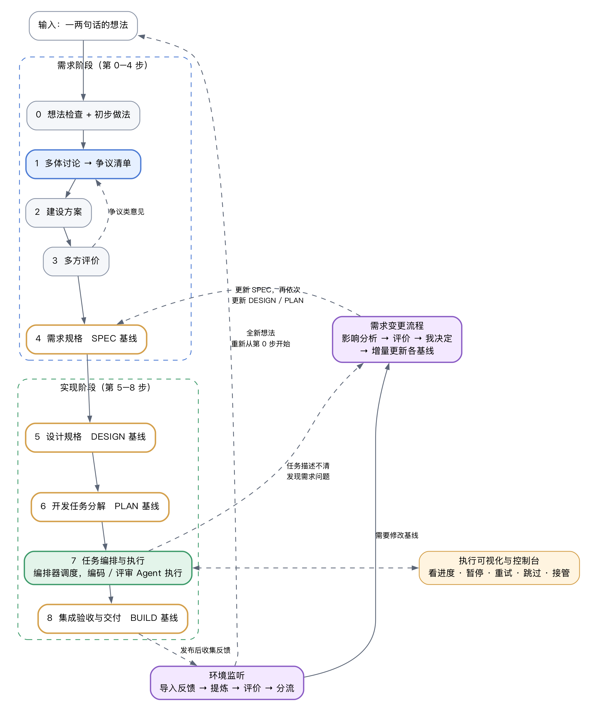
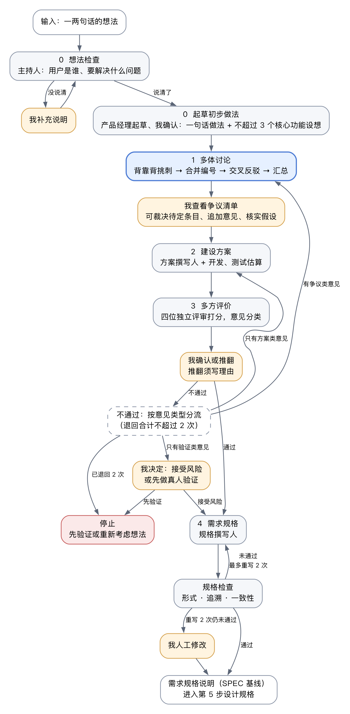
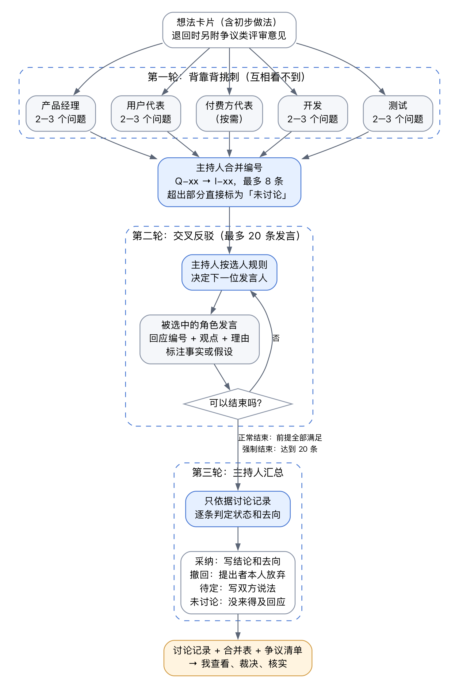
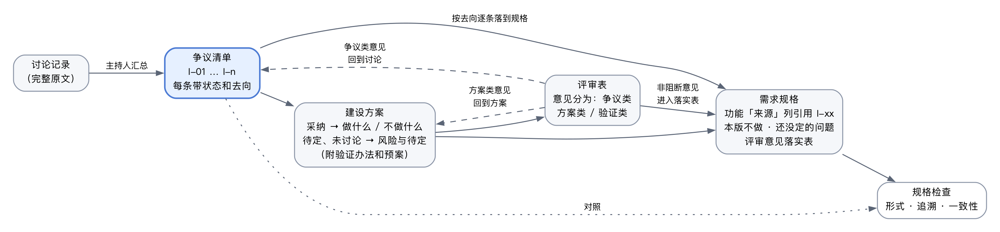
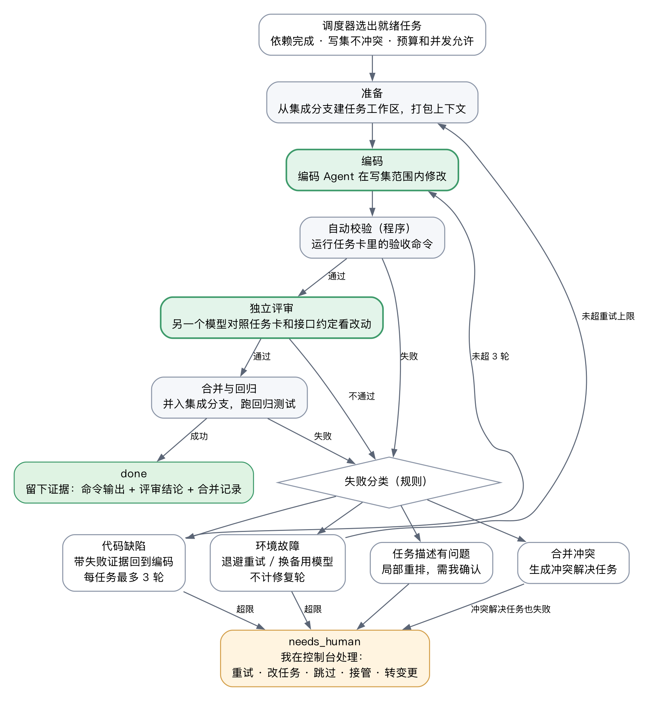
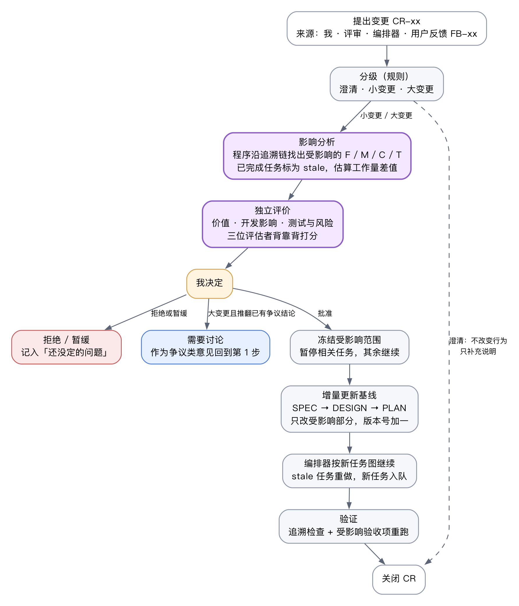
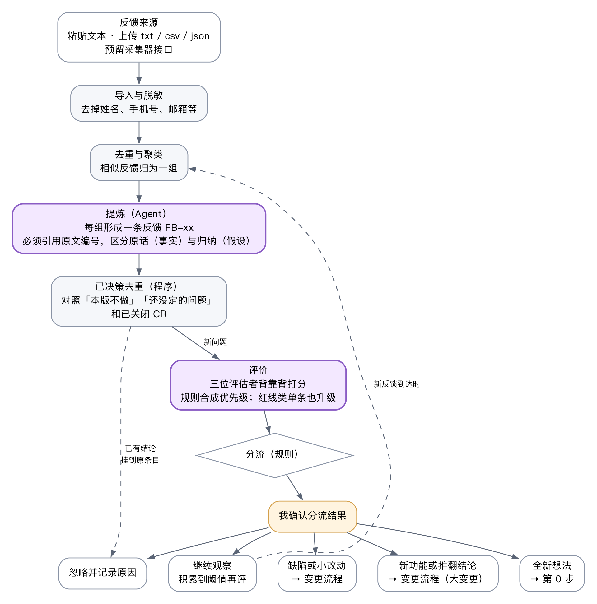

# 1 这份文档要回答什么

输入一两句话的产品想法，先经过「想法检查 → 多体讨论 → 建设方案 → 多方评价 → 需求规格」五步得到需求规格说明（第 0–4 步），再经过「设计规格 → 开发任务分解 → 任务编排与执行 → 集成验收」四步得到可运行的软件（第 5–8 步）。每一步都留下一份能直接给人看的结果。

这里的「多体」指多个角色一起工作：需求阶段由产品经理、用户代表、开发、测试各自挑刺，主持人控场和汇总；实现阶段由架构师、任务分解员、编码 Agent、评审 Agent 分工，由**编排器**调度。每个角色由一个 Agent 扮演，我在关键节点查看、裁决和拍板。

本文有两个重点。第一个是需求阶段：**多个 Agent 一起讨论时会出什么问题，这个流程怎么处理**（第 4 章是核心，第 5 章说明结论怎样传到需求规格，第 11 章用例子完整走一遍）。第二个是实现阶段：**需求规格怎样一路变成设计、任务和代码而不丢失，任务怎样被编排、监控和控制，需求变化和用户反馈怎样回流**（第 12–20 章）。

## 1.1 做什么

- 产品、用户、开发、测试四类角色分别挑刺，主持人合并、控场和汇总，形成争议清单。
- 把讨论结论收敛成建设方案，再由与讨论无关的评审打分；不通过时按意见类型退回到对应的步骤。
- 把通过的方案写成需求规格，并检查形式、追溯和一致性。
- 把需求规格逐级展开成设计规格、开发任务图，由编排器调度 Agent 完成编码、校验、评审和合并，并用验收结果对照需求规格。
- 提供执行的可视化和控制台：能看到每个任务的状态和证据，能暂停、重试、跳过、接管。
- 提供需求变更流程和环境监听：需求变化与用户反馈都先经过影响分析和评价，再由我决定是否改动基线。
- 关键节点由我确认或裁决，Agent 的结论不直接生效。

## 1.2 不做什么

- 需求阶段（第 0–4 步）不写设计和代码，需求规格只站在用户角度写功能；设计和代码从第 5 步开始。
- 不做真实的用户调研。依赖用户行为的假设，只能标为「待真人验证」，并给出验证办法。
- 不做精确排期，只给相对工作量（故事点）。
- 环境监听首版只处理我导入的反馈文本，不自动抓取外部平台，只预留采集器接口。
- 首版是单人使用的本地系统，不做多用户权限和分布式部署。

## 1.3 完整工作流一览

{width=72%}

| 步骤 | 做什么 | 留下的基线或产物 | 详见 |
|------|----------------|------------------|--------|
| 0–4 | 想法检查、多体讨论、建设方案、多方评价、需求规格 | 需求规格 SPEC | 第 2–11 章 |
| 5 | 把需求规格展开成模块、接口和数据的设计 | 设计规格 DESIGN | 第 13 章 |
| 6 | 把设计拆成带依赖、写集和验收命令的任务图 | 任务图 PLAN | 第 14 章 |
| 7 | 编排器调度 Agent 执行任务，程序校验，独立评审，合并 | 代码与证据 | 第 15 章 |
| 8 | 逐条对照需求规格验收，打包交付 | 验收报告、发布版本 BUILD | 第 17 章 |
| 贯穿 | 执行可视化与控制台 | 事件记录 | 第 16 章 |
| 贯穿 | 需求变更流程 | 变更单 CR、新版本基线 | 第 18 章 |
| 贯穿 | 环境监听、提炼与评价 | 反馈清单 FB | 第 19 章 |

第 20 章说明各角色使用什么模型，第 21 章汇总新增的人工介入点和产物，第 22 章列出还没定的问题。

# 2 需求阶段的总流程（第 0–4 步）

{width=62%}

| 步骤 | 输入 | 参与角色 | 产物 | 进入下一步的条件 |
|------------|---------------|---------------|---------------|------------------|
| 0 想法检查 | 想法原文 | 主持人、产品经理、我 | 想法卡片（含初步做法） | 用户、问题、初步做法都已写明 |
| 1 多体讨论 | 想法卡片；退回时附争议类评审意见 | 产品、用户代表、开发、测试、主持人 | 第一轮问题表、合并表、讨论记录、争议清单 | 正常结束或强制结束（第 4.6 节），并经我查看 |
| 2 建设方案 | 想法卡片、争议清单 | 方案撰写人；开发、测试估算 | 建设方案 | 包含全部规定章节，估算未超出容量 |
| 3 多方评价 | 想法卡片、建设方案 | 四位评审、我 | 评审表 | 满足通过规则并经我确认；不通过时按第 7.4 节分流 |
| 4 需求规格 | 想法卡片、建设方案、争议清单、评审表 | 规格撰写人、规格检查员 | 需求规格说明、检查报告 | 通过规格检查；重写 2 次仍未通过时由我人工修改。我确认后冻结为 SPEC 基线，进入第 5 步（第 12 章） |

流程的走向，也就是下一步做什么、退回到哪里、最多退回几次，都是事先定死的规则，不由任何一个 Agent 临场决定。只有第 1 步讨论内部，由主持人按规则决定下一个由谁发言。

## 2.1 第 0 步：想法检查与初步做法

第 0 步分两件事。

**想法检查。**主持人确认想法里说清了「用户是谁」和「要解决什么问题」，并判断使用者和付费方（或审批方）是不是同一类人；不是的话，讨论时加入付费方代表。没说清时由我补一句话，最多补 3 次，仍说不清就停止。

**起草初步做法。**产品经理写一句话做法，再列出不超过 3 个核心功能设想，由我确认。这一步是给讨论立一个「靶子」：第一轮挑刺时，测试可以追问这几个功能怎样算做好，开发可以说哪个做不了，用户可以说哪个不会用，而不是对着一句想法空猜。

初步做法只是靶子，不是结论。讨论后可以被修改、缩小，甚至推翻。

# 3 角色设计

## 3.1 讨论角色

每个讨论角色有三样东西：**立场**（替谁说话）、**必问清单**（发言前必须想过的问题）、**边界**（不该做的事）。

**产品经理**

- 立场：对产品能不能成立负责。第 0 步负责起草初步做法。
- 必问：痛点是不是真的？用户现在怎么凑合？和现有方案差在哪，差别够不够让人换？一个人、一个学期能做完的最小版本是什么？怎样算成功？
- 边界：不替用户回答「我会用」，不讨论技术实现。

**主要用户代表**

- 立场：每天使用产品的人。讨论开始时先设定一个具体的人（身份、作息、手头在用的工具），并写明人设依据，之后始终以这个人的身份、用第一人称发言。
- 必问：我在什么时间、什么地点、因为什么会想用它？初步做法里哪个功能我每天真的会用？换成新产品要付出什么代价？什么情况会让我用一次就不用了？
- 边界：不讨论技术，不替产品经理做决定。

**付费方或间接用户代表**

- 立场：掏钱、推荐、审批或管理的人，例如家长、老师、学校、后勤。只有当使用者和这类人不是同一类人时才加入。
- 必问：我为什么要花钱或花精力配合？我担心什么（安全、隐私、增加工作量、违反规定）？我和主要用户的利益在哪里冲突？
- 边界：同主要用户代表。

**开发**

- 立场：对能不能按时做出来负责。第 2 步参与估算。
- 必问：初步做法里哪些功能以现有能力做不出来？依赖哪些拿不到的数据或权限？哪些描述太模糊没法开工？砍掉哪些能换来按时交付？
- 边界：只指出风险和可以接受的缩小方案，不在讨论中展开技术设计。

**测试**

- 立场：对每个需求能不能被验证负责。第 2 步参与估算。
- 必问：初步做法里每个功能怎样算「做好了」？「好用」「准确」「快」具体指什么？有哪些边界情况（没网、数据为空、误操作、恶意使用）？哪些需求无法验证、应该改写？
- 边界：不能只说「需要测试」，必须给出具体场景或改写后的句子。

**主持人**

- 立场：中立，不发表观点。
- 职责：第一轮后合并问题并编号；第二轮按规则选人、点名、追问；判断能否结束；第三轮判定每条争议的状态和去向。
- 边界：不评价谁对谁错，不提出新需求，不能替提出者撤回问题。

## 3.2 撰写、检查与评审角色

| 角色 | 职责 | 边界 |
|-----------|----------------------------|----------------------------|
| 方案撰写人 | 把想法卡片和争议清单写成建设方案 | 只能使用初步做法和已采纳的结论；不能自己发明新功能，不能把待定写成已解决 |
| 规格撰写人 | 把建设方案写成需求规格 | 不看讨论记录，避免把已撤回或本版不做的想法重新写回来 |
| 规格检查员 | 按第 8.2 节逐项检查需求规格 | 只指出问题和位置，不自己修改 |
| 四位评审 | 按维度给建设方案打分、提意见并分类（第 7 节） | 与讨论角色是不同的 Agent，看不到讨论过程 |

方案撰写人和规格撰写人没有自己的立场，只负责忠实转写；需要取舍的地方，必须引用争议编号或写明理由。

## 3.3 谁能看到什么

各角色的信息边界决定了他们会不会被带偏，所以单独列出：

| 角色 | 能看到 | 看不到 |
|-----------|----------------------------|----------------------------|
| 讨论角色（第一轮） | 想法卡片；退回时的争议类评审意见 | 其他角色的第一轮问题 |
| 讨论角色（第二轮） | 想法卡片、第一轮问题表、合并表、讨论记录 | 评审表中的非争议类意见 |
| 方案撰写人 | 想法卡片、争议清单 | 讨论记录原文 |
| 四位评审 | 想法卡片、建设方案 | 讨论记录、争议清单 |
| 规格撰写人 | 想法卡片、建设方案、争议清单、评审表 | 讨论记录原文 |
| 规格检查员 | 需求规格、建设方案、争议清单、评审表 | — |

# 4 多体讨论的设计

## 4.1 设计原则

1. **先独立，后交锋。**每个角色先独立提出问题，再看到别人的意见，避免被先发言的人带偏。
2. **有靶子，有立场。**大家针对同一个初步做法挑刺；每个角色只替自己代表的那一方说话。
3. **分歧可以保留，不靠人多。**讨论的目标是把问题摆清楚，不是强行一致。没有「多数人反对就否决」；谈不拢就记为待定，由我裁决。
4. **结论可以追溯。**每个结论都能找到来源问题、提出者、谁回应、在什么条件下成立、最后落到规格的哪里。
5. **一定停得下来，且停下来时不丢东西。**发言条数、争议条数、退回次数都有上限；因为上限没讨论到的问题有明确的状态，不会凭空消失。

## 4.2 讨论的步骤

{width=72%}

**第一轮：背靠背挑刺。**除主持人外，每个角色单独阅读想法卡片，针对初步做法各写 **2 到 3 个**问题。每个问题写明编号（Q-01、Q-02……）、类别（价值、范围、可行性、可测性、竞争）、问题本身和理由。这一轮各角色互相看不到对方写了什么。4 到 5 个角色，共 8 到 15 个问题。

**合并编号。**主持人把第一轮的问题合并成争议，编号为 I-01、I-02……，规则见第 4.3 节。

**第二轮：交叉反驳。**各角色围绕争议发言。主持人按第 4.5 节的规则选人，按第 4.6 节的条件结束。

**第三轮：主持人汇总。**主持人只依据讨论记录，给每条争议判定状态和去向（第 4.7 节），不添加讨论里没出现过的观点。

## 4.3 合并与编号规则

- 实质相同的问题合并为一条争议。合并后的提出者是所有来源问题的角色。
- 每个 Q 编号都必须出现在合并表里，对应到某个 I 编号，保证背靠背阶段的问题不会在合并时悄悄丢失。
- 合并后最多保留 **8 条**进入第二轮。超过时，主持人按「不解决的话，产品还成不成立」排序，前 8 条进入第二轮，其余直接标为「未讨论」，并写明原因。
- 第二轮中有人提出新问题时，主持人接着编号记录，但本轮不展开，直接标为「未讨论」。这样讨论的范围在第二轮开始时就固定下来，不会越聊越多。

## 4.4 发言规则

第二轮的每条发言都要包含三部分：

- **回应对象**：回应的是哪个争议编号、哪位角色。
- **观点**：同意、反对、补充，或者对别人给出的回应表态。
- **理由**：为什么。

另外有四条约束：

- 每条发言最多涉及 3 个争议编号。
- 只说「同意」而没有补充新信息或理由的发言，视为无效，主持人会追问。
- 涉及竞品、数据、用户行为的说法，要标明是「事实」还是「假设」。用户代表基于人设的说法一律标为假设。
- 同一角色不能连续发言。

本文中的两个术语：

- **回应**：提出者以外的角色引用某个争议编号并给出观点。
- **表态**：提出者对别人的回应明确表示接受或不接受。提出者自己给出的结论，视为已接受。

## 4.5 主持人的选人规则

第二轮每条发言之前，主持人按下面的顺序决定由谁发言，排在前面的规则优先：

1. 如果连续 4 条发言都没有主持人，由主持人发言，进行点名、追问或小结。
2. 如果有角色被点名、但还没回应，由这个角色发言。
3. 如果有角色还没发过言，由这个角色发言。
4. 如果有争议还没被回应，由与之最相关、且不是提出者的角色发言。
5. 如果有争议已被回应、但提出者还没表态，由提出者发言。
6. 其余情况，由与当前争议最相关的角色发言。

## 4.6 结束条件

第二轮有两种结束方式。

**正常结束。**由主持人宣布，宣布前必须同时满足：

- 每条进入第二轮的争议都已被回应；
- 每个角色至少发言一次；
- 退回再讨论时，每条争议类评审意见对应的争议都已被回应。

**强制结束。**发言达到 **20 条**时立即结束，不论上面的前提是否满足。此时还没被回应的争议标为「未讨论」；已被回应但提出者还没表态的，标为「待定」。

前提一旦全部满足，主持人可以不按选人规则直接插话宣布结束。

两种方式的关系：20 条是硬上限，优先于一切；正常结束的前提只决定主持人能不能**提前**宣布结束，不会让讨论超过 20 条。

**为什么 20 条够用。**主持人在第 1 条开场，之后每隔最多 4 条插话一次，20 条中主持人占 4 到 5 条，其余角色至少有 15 条。最多 8 条争议，每条需要 1 次回应和 1 次表态，共 16 次；每条发言最多涉及 3 个编号，15 条发言最多能覆盖 45 次。因此正常情况下 12 到 16 条就能正常结束，强制结束是兜底手段。

## 4.7 争议清单

争议清单是讨论阶段最重要的产物，后面所有步骤都通过编号引用它。

| 字段 | 含义 |
|----------|------------------------------------------|
| 编号 | I-01、I-02…… |
| 来源问题 | 合并自哪些 Q 编号 |
| 提出者 | 来源问题的角色 |
| 类别 | 价值 / 范围 / 可行性 / 可测性 / 竞争 / 其他 |
| 问题 | 一句话描述 |
| 状态 | 采纳 / 撤回 / 待定 / 未讨论 |
| 结论或分歧点 | 采纳写结论及成立条件；撤回写理由；待定写各方说法；未讨论写原因 |
| 支持者、反对者 | 对当前结论或提议表示认可、反对的角色 |
| 依据类型 | 共识 / 事实 / 假设（不影响结论）/ 待真人验证 / 人工裁决 |
| 去向 | 功能 / 验收标准 / 非功能 / 本版不做 / 风险与待定 / 无 |

**四种状态的判定标准：**

| 状态 | 含义 | 判定条件 |
|--------|--------------------|------------------------------------------|
| 采纳 | 质疑成立，并形成了结论 | 被回应过；所有提出者都接受结论；没有角色坚持反对；通过反问检验 |
| 撤回 | 提出者认为问题不成立 | 只能由提出者本人在发言中明确撤回；合并条目需要所有提出者都撤回 |
| 待定 | 还没有结论 | 有角色坚持不同意见；或提出者没有表态；或没通过反问检验 |
| 未讨论 | 没被讨论到 | 合并时超出 8 条被截下；第二轮新提出；或强制结束时还没被回应 |

注意「采纳」的对象是**质疑**，不是提出者给出的做法。例如有人质疑「接入学校数据涉及隐私」，讨论后决定「第一版不接入学校数据」，这条质疑是**采纳**，结论去向是「本版不做」。

这里没有「多数反对即否决」。任何一个角色坚持反对，条目都会保持待定。这样即使只有一个角色提出了合规或安全上的红线，也不会被其他角色的人数压掉。待定条目最后由我裁决（第 9 节）。

**反问检验。**结论如果依赖某个假设，就问一句：「如果这个假设是错的，结论还成立吗？」

- 还成立：可以采纳，依据类型标为「假设（不影响结论）」。
- 不成立：只能记为待定，依据类型标为「待真人验证」。

## 4.8 讨论中的问题与对策

| 问题 | 表现 | 处理办法 |
|--------|----------------|-----------------------------|
| 对着空气挑刺 | 只有一句想法，测试不知道测什么，开发不知道砍什么 | 第 0 步由产品经理起草初步做法作为靶子，第一轮针对它挑刺 |
| 一团和气 | 各角色互相附和，没人真正挑刺 | 每个角色有必问清单；第一轮每人必须提出 2 到 3 个问题；只说「同意」算无效发言 |
| 锚定和从众 | 第一个发言的人定下基调，后面的人顺着说 | 第一轮背靠背独立提出问题，合并后才公开 |
| 问题太多讨论不完 | 十几个问题挤在有限的发言里，大部分没人回应 | 第一轮每人只提 2 到 3 个；合并后最多 8 条进入第二轮；其余明确标为未讨论 |
| 发言失衡 | 某个角色说个不停，另一个角色从头到尾没发言 | 同一角色不能连续发言；选人规则优先照顾被点名、没发言、没表态的角色；正常结束要求每个角色都发过言 |
| 跑题 | 讨论变成争论用什么技术、怎么写代码 | 每个角色有边界；第二轮只围绕已编号的争议展开；新问题不在本轮展开 |
| 停不下来 | 来回拉锯，同一个点反复争 | 20 条硬上限；连续 4 条没有主持人时主持人必须介入 |
| 停下来时丢东西 | 因为上限截断，没讨论到的问题消失了 | 合并表保证每个 Q 都有去处；没讨论到的标为未讨论，进入风险与待定和需求规格 |
| 多数压少数 | 一条红线被其他角色以人多为由否掉 | 不存在多数否决；撤回只能由提出者本人做；有人坚持就保持待定，由我裁决 |
| 强行一致 | 有分歧或依赖假设，却写成已有结论 | 采纳需要所有提出者接受并通过反问检验；否则记为待定 |
| 利益冲突被掩盖 | 只听使用者的，忽略付费方或管理方，或者反过来 | 两类用户由不同角色代表；双方冲突的地方单独记为一条争议 |
| 模拟用户不可信 | Agent 扮演的用户说得头头是道，但未必是真实用户的想法 | 用户代表要写明人设依据；基于人设的说法一律标为假设，并通过反问检验决定能否采纳 |
| 编造事实 | 随口说出「某竞品没有这个功能」「市场规模 X 亿」 | 必须标明事实或假设；我在讨论结束后核实，核实不了的按假设处理 |
| 交接时丢信息 | 讨论记录很长，汇总后只剩一句「已解决」 | 争议清单记录来源、条件、支持者、反对者和去向；后续每一步按编号引用，并在规格检查中核对（第 5、8 节） |
| 自己评自己 | 写方案的角色又去评方案 | 评审与讨论角色分开，评审看不到讨论过程；是否通过由规则判断，再经我确认 |
| 评审意见被敷衍 | 退回重新讨论后，原来的问题没人回应 | 退回的意见逐条变成争议；正常结束要求每条都被回应 |
| 无限退回 | 方案反复不通过，流程一直转 | 按意见类型退回到对应步骤；退回合计不超过 2 次；只能靠真人验证的问题由我决定，不再退回 |

## 4.9 退回后的再讨论

只有含「争议类」评审意见时才退回第 1 步（第 7.4 节）。再讨论与第一次有四点不同：

1. 输入是想法卡片、上一版争议清单，以及争议类评审意见（编号 R-01、R-02……）。
2. 第一轮各角色只针对这些评审意见背靠背表态，每人 1 到 2 点，可以附带新问题。
3. 合并时，每条评审意见要么并入一条已有争议（重新打开它），要么成为新争议，编号接着上一版往后排。没被评审意见涉及的已有条目保持原状态，不重新讨论。
4. 第三轮更新状态时，凡是状态有变化的条目，都要写明「上一版状态 → 本版状态」及原因。

上一版的所有产物都保留，方便对比这一轮改了什么。

# 5 讨论结论如何传到需求规格

多个 Agent 之间每交接一次，信息就会被压缩一次。这个流程用争议编号把各步串起来：前向看，每条争议都有去向；反向看，规格里每个功能都能找到来源。

{width=100%}

| 争议状态 | 在建设方案中 | 在需求规格中 | 怎么检查 |
|---------|---------------|---------------|---------------|
| 采纳 | 写进「做什么」或「不做什么」，注明编号 | 按去向写进功能、验收标准、非功能需求或「本版不做」，注明编号 | 每条采纳条目都能在去向位置找到编号 |
| 撤回 | 不出现 | 不出现 | 规格中不出现撤回条目的内容 |
| 待定、未讨论 | 写进「风险与待定」，附验证办法和预案 | 写进「还没定的问题」，注明编号 | 每条都能在第 4 章找到编号 |

评审表也有去向：评审通过时，所有非阻断意见进入需求规格附录的「评审意见落实表」，逐条写明落实位置或不采纳的理由。

# 6 建设方案

方案撰写人根据想法卡片和争议清单写方案，固定包含以下章节：

1. **电梯演讲**：给谁、什么需求、产品是什么、关键好处、和主要替代方案差在哪、怎么触达用户。
2. **NABCD**：需求、做法、好处、竞争、推广各一段。
3. **做什么**：在初步做法的基础上，按采纳的结论调整。每个功能注明来源（初步做法，或某个争议编号）。
4. **不做什么**：每一条注明来源（去向为「本版不做」的争议编号，或撰写人的范围判断及理由）。不规定最少条数。
5. **大致怎么实现**：只写模块级思路。
6. **功能清单**：每项一行，不超过 12 项。
7. **风险与待定**：所有待定和未讨论的条目，每条都写明**验证办法**（怎么验证、多久、看什么数据）和**不成立时的预案**。
8. **估算**：开发和测试分别用斐波那契数（1、2、3、5、8、13、21）给每个功能打故事点。两人差距超过两档时，各自说明理由后重估一次；仍有分歧就取较大值，并标注「有分歧」。这一步就是课上讲的 Planning Poker。估算总和不能超过我设定的容量；超出时，撰写人必须把部分功能移到「不做什么」或降级，并写明理由。

方案不能把待定条目写成已经解决，也不能出现既不来自初步做法、也不来自采纳结论的新功能。

# 7 多方评价

## 7.1 评审角色

评审角色与讨论角色分开，只看想法卡片和建设方案。

| 维度 | 评审角色 | 关注点 |
|-------------|----------|---------------------------------|
| 用户价值 | 用户评审 | 是否解决真实痛点，场景是否可信 |
| 可行性与成本 | 开发评审 | 范围和估算是否在容量之内 |
| 可测性与风险 | 测试评审 | 每个核心功能能否写出验收标准；待定条目的验证办法是否可行 |
| 竞争力 | 专家评审 | NABCD 是否说圆，后进者凭什么赢 |

**待定条目本身不扣分。**评审看的是：待定条目有没有给出可行的验证办法和预案，以及 P0 功能是否建立在待定条目之上。这样「不做真实调研」的边界不会让方案注定通不过。

## 7.2 评分标准

| 分数 | 含义 |
|------|------------------------------------------|
| 5 | 可以直接写需求规格 |
| 4 | 有小问题，写需求规格时顺手补上即可 |
| 3 | 有明显问题，但可以在需求规格里补 |
| 2 | 有主要问题，需要退回修改 |
| 1 | 方向错误 |

## 7.3 通过规则

同时满足以下三条，才算评审建议通过：

- 四个维度平均分不低于 3.5；
- **任一维度不低于 3 分**，即只要有一个维度打出 2 分或以下，就不通过；
- 没有阻断性意见。

然后由我确认。我可以推翻评审的建议，但必须写一句理由，记录在评审表里。

## 7.4 意见分类与退回分流

每位评审写的每条意见，都要标明是否「阻断」，并归入以下三类之一：

| 类型 | 含义 | 例子 |
|--------|------------------------|------------------------------------|
| 争议类 | 对某条结论有异议，或发现了讨论中没涉及的新问题 | 「I-05 的结论忽略了无障碍需求」 |
| 方案类 | 讨论结论没问题，是方案写得不好或范围过大 | NABCD 前后矛盾、功能拆得太粗、估算超出容量 |
| 验证类 | 只能靠真人验证才能消除 | 「上报量能否足够，现在无法判断」 |

我在确认时可以调整评审给出的分类。不通过时按下面的顺序分流：

1. 有争议类意见：回到第 1 步，只讨论这些意见（第 4.9 节）。
2. 没有争议类、但有方案类意见：回到第 2 步，由方案撰写人修改方案，然后重新评价，不重新讨论。
3. 只有验证类意见：由我决定是**接受风险**（进入第 4 步，这些问题写进需求规格的「还没定的问题」，附验证办法）还是**先做真人验证**（停止流程）。这种情况不算退回。

第 1、2 两种退回合计不超过 2 次。第 3 次仍不通过就停止，由我决定先做验证还是重新考虑想法。

评审通过时，所有非阻断意见进入需求规格附录的「评审意见落实表」。

# 8 需求规格

## 8.1 结构

规格撰写人的输入是想法卡片、建设方案、争议清单和评审表，**不包括讨论记录原文**，避免把已撤回或本版不做的想法重新写回来。需求规格站在用户角度写功能，不写实现，结构固定为四章加一个附录。

**第 1 章 用户与场景。**每类用户一段画像；每个画像至少一个完整场景，即从产生需求到需求被满足的几个步骤。场景编号为 S1、S2……

**第 2 章 功能。**

2.1 功能列表：

| 编号 | 功能 | 用户故事 | 对应场景 | 优先级 | 影响 | 验收标准 | 来源 |
|------|---------|---------------|---------|---------|---------|------------|---------|
| F1 | 功能名称 | 作为……，我想……，以便…… | S1 | P0 | 不做会怎样 | 可以验证的标准 | 初步做法 / I-xx |

优先级分为 P0（没有就不能用）、P1（第一版应有）、P2（以后再说）。

2.2 本版不做：每一条注明来源编号或理由。

**第 3 章 非功能需求。**易用性、性能、可靠性、隐私等，每条都要可以验证；来自争议的注明编号。

**第 4 章 还没定的问题。**所有待定、未讨论条目（带编号），以及依据类型为「待真人验证」的条目，每条附验证办法和预案。

**附录 评审意见落实表。**每条非阻断评审意见一行：意见内容、处理结果（落实在哪一节，或不采纳的理由）。

## 8.2 规格检查

规格检查员按三类逐项检查。

**形式检查**

- 四章和附录齐全；
- 每个功能都填了优先级、影响、对应场景、验收标准和来源，且对应场景在第 1 章中存在；
- 至少有一个 P0 功能。

**追溯检查**

- 每条采纳条目都能在它的去向位置（功能、验收标准、非功能需求或「本版不做」）找到编号；
- 每条待定、未讨论条目都出现在第 4 章；
- 每个功能的来源是初步做法或某条采纳条目，没有凭空出现的功能；
- 每条非阻断评审意见都在落实表中有处理结果。

**一致性检查**

- 「本版不做」中的内容没有出现在功能列表中；
- 撤回条目的内容没有被写成需求；
- P0 功能没有建立在待定条目之上；如果有，必须在第 4 章中说明。

检查不通过时，把问题清单交回规格撰写人重写，最多 2 次。仍不通过时由我人工修改，并在检查报告中写明哪些检查项由人工处理。

# 9 人工介入点

以下是第 0–4 步的介入点；第 5–8 步及变更、监听的介入点见第 21.1 节。

| 时机 | 我做什么 |
|-------------|------------------------------------------------|
| 想法检查不通过 | 补一句话说明用户或问题，最多补 3 次 |
| 初步做法完成后 | 确认或修改产品经理写的初步做法 |
| 讨论结束后 | 查看合并表和争议清单；裁决待定或未讨论条目；追加意见；核实标为假设的说法 |
| 评价之后 | 确认是否通过，推翻时写理由；必要时调整意见分类；只有验证类意见时决定接受风险或先验证 |
| 退回 2 次后仍不通过 | 决定先做真人验证，还是重新考虑想法 |
| 规格检查重写 2 次仍未通过 | 人工修改需求规格 |
| 需求规格完成后 | 人工修改，作为正式提交版本 |

**裁决规则。**讨论结束后，我可以把待定或未讨论条目裁决为：

- **采纳**：写明结论和去向，依据类型记为「人工裁决」，并写一句理由；
- **撤回**：认定这条质疑在本版不成立，同样记为「人工裁决」并写理由。

裁决可以让流程向前推进，但不能把没验证的假设变成事实。如果裁决的结论依赖「待真人验证」的假设，这条仍要出现在需求规格的第 4 章，并附验证办法。

追加的意见按新编号加入争议清单，状态为待定。核实过的说法，依据类型改为「事实」；核实不了的保持「假设」。

# 10 每一步留下的结果

以下是第 0–4 步的产物；第 5–8 步及变更、监听的产物见第 21.2 节。

| 结果 | 来自 | 给人看什么 |
|--------------|-----------|--------------------------------------|
| 想法卡片 | 第 0 步 | 用户、问题、是否需要付费方代表、初步做法 |
| 第一轮问题表 | 第 1 步 | 每个角色背靠背提出的问题，带编号、类别和理由 |
| 合并表 | 第 1 步 | 每个 Q 编号对应到哪个 I 编号 |
| 讨论记录 | 第 1 步 | 第二轮原文，每条发言带序号和角色 |
| 争议清单 | 第 1 步 | 第 4.7 节的全部字段，以及我的裁决记录 |
| 建设方案 | 第 2 步 | 第 6 节的八个章节 |
| 评审表 | 第 3 步 | 各维度得分、意见及分类、我的结论和理由 |
| 需求规格说明 | 第 4 步 | 第 8.1 节的四章和附录 |
| 规格检查报告 | 第 4 步 | 三类检查的结果，以及人工处理的项目 |

发生退回时，所有产物另存新版本，旧版本保留。

# 11 示例走查

下面用一个虚构的想法走一遍第 0 步和第 1 步，展示讨论中的问题怎样被处理，最后逐条对照规则自查。示例中的发言是为说明流程而编写的。

## 11.1 想法卡片

想法原文：「做一个帮同学在期末周找到有空位自习室的小程序。」

| 项目 | 内容 |
|--------|------------------------------------------------|
| 用户 | 期末周需要自习、没有固定座位的本校本科生 |
| 问题 | 期末周自习室座位紧张，跑了几栋楼都找不到空位，浪费时间 |
| 付费方或间接用户 | 使用者不付费；但教学楼由后勤管理，能否在楼内张贴、是否提供数据由后勤决定，因此加入后勤代表 |
| 初步做法 | 按教学楼和楼层列出自习教室，到场的同学上报剩余座位数，其他同学查看 |
| 核心功能设想 | ① 按楼栋和楼层查看剩余座位；② 上报剩余座位数；③ 收藏常去的教室 |

## 11.2 第一轮：背靠背挑刺

用户代表的人设：大二学生小林，住校、没有固定自习座位，期末周每天都要找座位（依据：想法卡片中的用户描述）。后勤代表的人设：负责教学楼日常管理的老师（依据：想法卡片中的间接用户描述）。

| 编号 | 角色 | 类别 | 问题 | 理由 |
|---------|------------|---------|---------------------------|------------------|
| Q-01 | 产品经理 | 竞争 | 学生现在在微信群里问「哪里有位」，我们比群聊好在哪？ | 群聊零成本，大家已经习惯 |
| Q-02 | 产品经理 | 范围 | 第一版覆盖几栋楼？ | 全校铺开会把上报量摊薄 |
| Q-03 | 用户代表 | 价值 | 我到了楼下才会想查，要是还得先登录，我宁可直接上楼看 | 查询必须比直接上楼看更快 |
| Q-04 | 用户代表 | 价值 | 信息过期了，我会白跑一趟 | 白跑一次我就不再相信它 |
| Q-05 | 后勤代表 | 可行性 | 接入门禁或摄像头数据涉及隐私，学校不一定愿意提供 | 需要审批和隐私评估 |
| Q-06 | 后勤代表 | 范围 | 会不会有人刷假消息，或者借此占座 | 楼里已经有占座纠纷 |
| Q-07 | 开发 | 可行性 | 上报靠手动输入，数字可能填错或乱填 | 没有校验手段 |
| Q-08 | 开发 | 可行性 | 上报的人少时信息很稀疏 | 冷启动阶段用户少 |
| Q-09 | 测试 | 可测性 | 「有空位」怎么定义？一间教室剩 1 个座位算不算？ | 定义不清就写不出验收标准 |
| Q-10 | 测试 | 可测性 | 一条上报多久以前的算过期？ | 同上 |

五个角色各提了 2 个问题，共 10 个。后勤代表提出的隐私和占座问题，是只有使用者视角时容易漏掉的。

## 11.3 合并表

| 争议 | 合并自 | 提出者 | 问题 |
|------|------------|------------|---------------------|
| I-01 | Q-05 | 后勤代表 | 是否接入学校的门禁或摄像头数据 |
| I-02 | Q-04、Q-09、Q-10 | 用户代表、测试 | 「有空位」如何定义，多久算过期 |
| I-03 | Q-08 | 开发 | 上报的人够不够 |
| I-04 | Q-01 | 产品经理 | 比微信群好在哪 |
| I-05 | Q-03 | 用户代表 | 查询门槛（是否需要登录） |
| I-06 | Q-06、Q-07 | 后勤代表、开发 | 上报的数据是否可信 |
| I-07 | Q-02 | 产品经理 | 第一版覆盖范围 |

10 个问题合并为 7 条争议，未超过 8 条，全部进入第二轮；每个 Q 编号都有对应的争议。

## 11.4 第二轮：交叉反驳

每条发言前的方括号是发言序号，括号后的说明是按第 4.5 节哪条规则选中了这位发言人。

> **[1] 主持人**（开场）：第一轮的 10 个问题已合并为 7 条争议。I-01 决定了数据从哪里来，是其他争议的前提，请开发先回应。
>
> **[2] 开发**（规则 2，被点名）：回应 I-01。建议第一版不依赖学校数据，只用学生上报。理由：接入要经过学校审批（依据：事实），能否通过、要多久都不由我们决定，不应该让第一版卡在这里。
>
> **[3] 后勤代表**（规则 3，未发言）：对 I-01 表态：接受，这样也避开了隐私评估。对 I-06 提议：同一账号 10 分钟内只能上报一次，可以减少刷假消息。（依据：假设，刷假消息的情况尚未发生）
>
> **[4] 测试**（规则 3，未发言）：回应 I-06：限频可以验证，同一账号 10 分钟内第二次上报应被拒绝。对 I-02 提议：不判断「有没有空位」，而是显示上报的剩余座位数和上报时间，超过 30 分钟标灰；剩 1 个座位算不算，由用户自己判断。
>
> **[5] 用户代表**（规则 3，未发言）：对 I-02 表态：显示剩余座位数和时间，我接受。回应 I-03：如果大部分信息都是灰的，我第二次就不会打开了。（依据：假设，来自人设）
>
> **[6] 主持人**（规则 1，已连续 4 条）：I-02 还需要提出者以外的角色回应；I-05 还没有人回应，请开发说明。产品经理还没发言。
>
> **[7] 开发**（规则 2，被点名）：回应 I-05：查看不需要登录、上报才需要登录，可以做到。回应 I-02：显示剩余座位数和上报时间没有实现难度。对 I-06 表态：接受限频；填错的数字靠超时标灰兜底。
>
> **[8] 产品经理**（规则 3，未发言）：回应 I-03：第一版只覆盖一栋教学楼，把上报集中起来，这也是我对 I-07 的提议。但能不能凑够上报量，只能靠真人试点验证。（依据：假设）
>
> **[9] 后勤代表**（规则 4，I-07 未被回应）：回应 I-07：只做一栋楼我同意，我们可以配合在楼内张贴二维码。
>
> **[10] 用户代表**（规则 4，I-04 未被回应）：回应 I-04：群里问经常没人回，回了也是半小时前的消息，按楼层看剩余座位比翻聊天记录快。（依据：假设，来自人设）对 I-05 表态：查看免登录，我接受。
>
> **[11] 主持人**（规则 1，已连续 4 条）：I-03 和 I-04 的提出者还没表态。请产品经理对 I-04 表态，再请开发对 I-03 表态。
>
> **[12] 产品经理**（规则 2，被点名）：对 I-04 表态：这个优势成立的前提是上报量足够，依赖 I-03，所以 I-04 不能算有结论，保留待定。对 I-07 表态：按一栋楼执行。
>
> **[13] 开发**（规则 2，被点名）：对 I-03 表态：单栋楼试点能缓解，但上报量够不够现在不知道，我不接受把它当作已解决，保留待定。
>
> **[14] 主持人**（正常结束）：7 条争议都已被提出者以外的角色回应，五个角色都发过言，满足正常结束的前提。仍有分歧的是 I-03 和 I-04。讨论结束。

## 11.5 第三轮：争议清单

表 A 是每条争议的内容和状态：

| 编号 | 提出者 | 类别 | 问题 | 状态 | 结论或分歧点 |
|---------|------------|---------|---------------|------|---------------------------|
| I-01 | 后勤代表 | 可行性 | 是否接入学校数据 | 采纳 | 第一版不接入学校数据，空位信息只来自学生上报 |
| I-02 | 用户代表、测试 | 可测性 | 「有空位」定义与过期时间 | 采纳 | 显示上报的剩余座位数和上报时间，超过 30 分钟标灰；不判断「有没有空位」 |
| I-03 | 开发 | 可行性 | 上报的人够不够 | 待定 | 用户代表认为信息稀疏会导致流失；产品经理提议单栋楼试点；能否凑够上报量未知 |
| I-04 | 产品经理 | 竞争 | 比微信群好在哪 | 待定 | 用户代表认为按楼层看比翻群聊快；产品经理认为该优势依赖 I-03 |
| I-05 | 用户代表 | 价值 | 查询门槛 | 采纳 | 查看无需登录，上报需要登录 |
| I-06 | 后勤代表、开发 | 范围 | 上报数据是否可信 | 采纳 | 同一账号 10 分钟内只能上报一次；填错的数据靠超时标灰兜底 |
| I-07 | 产品经理 | 范围 | 第一版覆盖范围 | 采纳 | 第一版只覆盖一栋教学楼 |

表 B 是追溯信息，「回应」和「表态」一栏写的是第 11.4 节中的发言序号：

| 编号 | 来源问题 | 回应 | 表态 | 支持者 | 反对者 | 依据类型 | 去向 |
|---------|---------------|------------|------------|------------------|------------|---------------|------------|
| I-01 | Q-05 | [2] | [3] | 开发、后勤代表 | 无 | 共识 | 本版不做 |
| I-02 | Q-04、Q-09、Q-10 | [7] | [4]、[5] | 测试、用户代表、开发 | 无 | 共识 | 功能、验收标准 |
| I-03 | Q-08 | [5]、[8] | [13] | 产品经理（提议单栋试点） | 开发（保留） | 待真人验证 | 风险与待定 |
| I-04 | Q-01 | [10] | [12] | 用户代表 | 产品经理（保留） | 待真人验证 | 风险与待定 |
| I-05 | Q-03 | [7] | [10] | 开发、用户代表 | 无 | 假设（不影响结论） | 功能 |
| I-06 | Q-06、Q-07 | [4] | [3]、[7] | 后勤代表、测试、开发 | 无 | 假设（不影响结论） | 功能、验收标准 |
| I-07 | Q-02 | [9] | [8]、[12] | 产品经理、后勤代表 | 无 | 共识 | 本版不做 |

表态栏中，[3]、[4]、[8] 是提出者自己给出结论，按第 4.4 节视为已接受。

几处值得注意的判定：

- **I-05 与 I-04 都依赖假设，状态却不同。**I-05 的结论「查看免登录」依赖「用户到楼下才查」这个人设假设；即使假设是错的，免登录查看也没有坏处，通过反问检验，可以采纳。I-04 的结论依赖「上报量足够」；如果这个假设是错的，结论就不成立，只能待定。
- **I-01 是采纳，不是否决。**后勤代表的隐私质疑成立，被采纳的结论是「第一版不接入学校数据」，去向是本版不做。
- **待定没有被人数压下。**I-04 中用户代表认为有优势，但提出者产品经理不接受；I-03 中产品经理提出了试点办法，但提出者开发不接受把它当作已解决。两条都保持待定，留给我裁决。

## 11.6 讨论之后

我查看争议清单后，没有裁决 I-03 和 I-04：两者都需要真人验证，裁决也不能把假设变成事实。于是它们进入建设方案的「风险与待定」，方案撰写人需要为它们写出验证办法和预案，例如「在一栋楼试点两周，统计每天的上报条数；如果明显偏少，改为在固定时段推送上报提醒」。

其余条目按去向流动：I-01、I-07 进入方案的「不做什么」和规格的「本版不做」；I-02、I-05、I-06 进入方案的「做什么」，并在规格中成为带「来源」编号的功能和验收标准。

## 11.7 规则自查

| 规则 | 出处 | 示例中的体现 |
|------------------|------|---------------------------|
| 有初步做法作为靶子 | 2.1 | 11.1 列出三个核心功能设想，第一轮问题都针对它们 |
| 第一轮每人 2 到 3 个问题，带编号、类别和理由 | 4.2 | 11.2 每人 2 个，共 10 个 |
| 每个 Q 都有去处，合并后不超过 8 条 | 4.3 | 11.3 合并为 7 条，Q-01 到 Q-10 全部对应 |
| 按选人规则决定发言人 | 4.5 | 11.4 每条发言都注明了依据的规则 |
| 连续不超过 4 条没有主持人 | 4.5 | 主持人在 [1]、[6]、[11]、[14] 发言，中间最多连续 4 条 |
| 同一角色不连续发言 | 4.4 | [1] 到 [14] 没有相邻的同一角色 |
| 每条发言最多涉及 3 个编号 | 4.4 | 最多的 [7] 涉及 I-05、I-02、I-06 三个 |
| 事实和假设分别标注 | 4.4 | [2] 标为事实；[3]、[5]、[8]、[10] 标为假设 |
| 正常结束的三个前提 | 4.6 | 表 B 中每条争议都有提出者以外的「回应」；五个角色都发过言；共 14 条，未达上限 |
| 采纳需要所有提出者接受并通过反问检验 | 4.7 | 采纳条目在表 B 中都有全部提出者的「表态」；I-05 与 I-04 的区别 |
| 没有多数否决 | 4.7 | I-03、I-04 都由提出者保留为待定 |
| 争议清单字段齐全 | 4.7 | 表 A 与表 B 合起来覆盖全部十个字段 |

# 12 从需求规格到交付：扩展部分的总体设计

第 2–11 章解决了「想清楚做什么」。这一章起解决「怎样把它做出来，并在做的过程中应对变化」。实现阶段仍然沿用前面的做法：流程走向由规则定死，Agent 只在规则划定的范围内发言和写作，关键节点由我确认。

## 12.1 设计原则

前面的五条原则（第 4.1 节）继续适用。实现阶段增加六条：

1. **规则定流向，Agent 不临场决定。**任务先做哪个、失败后退回哪里、最多重试几次、什么时候转人工，都由编排器按规则执行；Agent 只负责写设计、写代码、写评审意见。
2. **基线冻结，只能通过变更修改。**需求规格、设计规格、任务图、发布版本都是带版本号的基线。基线形成后，任何改动都必须先成为一张变更单（第 18 章），不能由 Agent 或我在流程中途悄悄改。
3. **谁做的谁不评。**写代码的 Agent 不评自己的代码，评审使用不同的上下文，并尽量使用不同厂商的模型（第 20 章），避免同一个模型对自己的输出打高分。
4. **完成必须有证据。**一个任务算完成，依据是验收命令的真实输出、独立评审的结论和合并记录，而不是 Agent 说「我做完了」。
5. **一个入口接收变化。**需求变更、评审发现的问题、编排器发现的任务缺陷、用户反馈，都以变更单的形式进入同一条流程，经过影响分析和评价后由我决定。
6. **人随时看得见、停得住、改得动，每个动作留痕。**所有状态变化、控制操作和 Agent 的调用都写入只追加的事件记录，刷新页面或重启后可以恢复和回看。

## 12.2 基线与版本

| 基线 | 内容 | 形成时机 | 修改方式 |
|--------|------------------------------|--------------------------|------------------|
| SPEC | 需求规格（含附录） | 第 4 步规格检查通过，我确认 | 只能通过变更单 |
| DESIGN | 设计规格 | 第 5 步评审通过，我确认 | 只能通过变更单 |
| PLAN | 任务图（任务卡及依赖） | 第 6 步分解检查通过，我确认 | 变更单引起的增量调整；或编排器的局部重排（第 15.8 节），须我确认 |
| BUILD | 集成分支上的代码和验收报告 | 第 8 步验收通过，我确认 | 只能通过变更单后重新执行相关任务 |

版本号用 `主版本.次版本` 表示：澄清和小变更把次版本加 1，大变更把主版本加 1。每次变更后，三份文档在同一个版本号下同时更新，并保留所有旧版本，方便对比。

## 12.3 追溯链

第 5 章用争议编号把讨论结论串到需求规格。实现阶段把这条链接着往后延伸：

| 编号 | 含义 | 产生于 |
|------|------------------------|--------------------|
| I-xx | 争议 | 第 1 步 |
| S、F、N | 场景、功能、非功能需求 | 第 4 步（功能原编号为 F1、F2……，非功能为 N1、N2……） |
| M | 设计模块 | 第 5 步 |
| C | 模块间的接口约定 | 第 5 步 |
| T-xx | 开发任务 | 第 6 步 |
| A-xx | 任务的一次执行尝试 | 第 7 步 |
| CR-xx | 变更单 | 任何时候 |
| FB-xx | 用户反馈条目 | 环境监听 |
| R-xx | 评审意见 | 第 3 步及各评审环节 |

完整的链条是：**争议 I → 功能或非功能 F/N → 模块 M → 接口 C → 任务 T → 尝试 A → 代码文件和测试 → 验收结果**。每一环都记录它的上游编号。

追溯矩阵由程序根据这些编号生成，不由 Agent 编写。这样做有两个好处：一是 Agent 不会「编造」追溯关系；二是变更时可以沿着链条自动找出受影响的部分（第 18.3 节）。

## 12.4 第 5–8 步总表

| 步骤 | 输入 | 参与角色 | 产物 | 进入下一步的条件 |
|------------|------------------|----------------|----------------|------------------|
| 5 设计规格 | SPEC | 架构师、两位设计评审、设计检查员、我 | 设计规格、设计检查报告、设计评审表 | 通过设计检查和评审，我确认 |
| 6 任务分解 | SPEC、DESIGN | 任务分解员、开发和测试估算、分解检查（程序加检查员）、我 | 任务图 | 通过分解检查，估算未超容量，我确认 |
| 7 编排与执行 | PLAN、DESIGN 中的接口约定 | 编排器、编码 Agent、测试 Agent、代码评审 Agent、我（控制台） | 集成分支上的代码、每个任务的证据 | 全部任务 done 或被我明确跳过 |
| 8 验收与交付 | SPEC、BUILD 候选 | 验收员、我 | 验收报告、发布版本 | 所有 P0 验收通过，我确认 |

# 13 第 5 步：设计规格

## 13.1 做什么、不做什么

设计规格回答「用什么模块、怎样分工、模块之间怎样说话」，让后面的任务分解员能把它拆成可以独立完成的任务。

- 做：划分模块，写每个模块的职责、对外接口和依赖；写模块间的接口约定；写数据结构；记录关键取舍及其理由。
- 不做：不写代码，不写类和函数级别的实现，不引入需求规格里没有的功能。需求规格中的「本版不做」在设计里也不做。

## 13.2 角色

| 角色 | 职责 | 边界 |
|-----------|----------------------------|----------------------------|
| 架构师 | 把需求规格写成设计规格 | 只能使用 SPEC 中的功能、非功能需求和已采纳的结论；不能添加新功能；待定条目只能写成有预案的设计，不能当作已确定 |
| 架构评审 | 看结构：模块划分是否合理、接口是否清楚、有没有过度设计、技术选择是否可行 | 与架构师是不同的 Agent，使用不同厂商的模型；看不到讨论记录 |
| 质量评审 | 看可测试性和可维护性：每个接口能不能单独测试，P0 功能的验收标准能不能落到某个模块 | 同上 |
| 设计检查员 | 按第 13.4 节逐项检查 | 只指出问题和位置，不自己修改 |

## 13.3 设计规格的结构

固定为六章加一个附录：

1. **目标与约束。**引用 SPEC 的 P0 和非功能需求；写明团队容量、运行环境、技术约束。
2. **总体结构。**模块列表，每个模块一行：编号 M1、M2……，名称，一句话职责，来源（F、N 编号）。**模块总数不超过 10 个**，超过说明划分得太细或功能太多，要先回到需求阶段缩小范围。
3. **模块设计。**每个模块写：职责、对外提供的接口、依赖的模块、持有的数据、对应的功能和非功能需求。
4. **接口约定。**每条接口 C1、C2……：提供方、调用方、输入输出的字段、可能的错误。**接口约定是任务分解的基础**：并行执行的任务靠它对齐，而不是互相看对方的代码。
5. **数据设计。**核心数据对象、字段、保存方式。
6. **关键决策与风险。**每条决策写明可选项、选择、理由和来源（争议编号或评审意见编号）。待定条目对应的设计预案也写在这里。

**附录 追溯矩阵。**列出每个 F、N 对应哪些模块和接口。矩阵由程序根据设计规格中填写的「来源」生成。

## 13.4 设计检查

**形式检查**

- 六章和附录齐全；
- 每个模块、每条接口都有编号和来源；
- 每条接口都同时有提供方和调用方，且这两个模块存在。

**追溯检查**

- 每个 P0、P1 功能至少对应一个模块；
- 每个模块至少来自一个功能或非功能需求，没有凭空出现的模块；
- 每条非功能需求在某个模块或决策中有落实；
- 每条待定、未讨论条目如果影响设计，都在第 6 章有预案。

**一致性检查**

- 「本版不做」的内容没有出现在模块职责中；
- 模块总数不超过 10；
- 模块之间的依赖没有环（有环就说明边界划分有问题）；
- 估算容量范围内可以完成（由第 14 章的估算复核）。

## 13.5 设计评审与退回

评审沿用第 7 章的做法：两位评审背靠背按 1–5 分打分，意见标明是否阻断。通过规则相同：平均分不低于 3.5，任一维度不低于 3，没有阻断性意见；然后由我确认。

意见按来源分类，不通过时按下面的顺序分流：

| 类型 | 含义 | 去向 |
|--------|------------------------|------------------------------|
| 设计类 | 设计本身的问题，如耦合过紧、接口缺字段 | 回到架构师重写（含第 13.4 节的检查失败） |
| 需求类 | 设计时发现需求规格自相矛盾、有遗漏或做不到 | 不在设计里自行「解决」，提交变更单（第 18 章） |
| 验证类 | 需要先做小实验才能判断，例如某个接口能否满足性能要求 | 在第 6 步里加入「探索任务」，在正式任务前先做 |

设计类退回合计不超过 2 次，仍不通过由我人工修改。

## 13.6 设计阶段的问题与对策

| 问题 | 表现 | 处理办法 |
|--------|----------------|-----------------------------|
| 偷偷加功能 | 架构师写进需求里没有的模块 | 每个模块必须有来源；追溯检查发现无来源的模块即不通过 |
| 过度设计 | 为将来扩展拆出很多层和接口 | 模块数上限 10；质量评审专门看有没有不属于本版需求的设计 |
| 接口含糊 | 写成「模块 A 把数据传给模块 B」，没有字段和错误 | 接口约定必须列出输入、输出和错误；缺项的接口不能被任务引用 |
| 把待定当已定 | 设计里默认了某个待真人验证的结论 | 设计检查要求这类条目在第 6 章有预案；评审看 P0 功能是否建立在待定条目之上 |
| 同模型自评自赞 | 架构师和评审用同一个模型，互相认可 | 评审使用不同厂商的模型，看不到架构师的推理过程 |
| 设计偏离需求 | 为方便实现而改变功能含义 | 追溯矩阵对照验收标准，评审要对照 SPEC 原文 |

# 14 第 6 步：开发任务分解

## 14.1 做什么

把设计规格拆成一张**任务图**：节点是任务卡，边是依赖。任务图要满足两个要求：每个任务都小到一个 Agent 能在一次执行里做完并验证；所有任务合起来能覆盖全部 P0 和 P1 功能。

## 14.2 角色

| 角色 | 职责 | 边界 |
|-----------|----------------------------|----------------------------|
| 任务分解员 | 根据 SPEC 和 DESIGN 写任务卡、定依赖 | 不添加 DESIGN 里没有的模块；不改接口约定 |
| 开发、测试（估算） | 给每个任务打故事点 | 沿用第 6 章第 8 项的 Planning Poker：差距超过两档时各说理由后重估，仍有分歧取较大值并标注「有分歧」 |
| 分解检查 | 先由程序做能确定的检查，再由检查员 Agent 做语义检查 | 检查员只指出问题，不自己修改 |

## 14.3 任务卡

| 字段 | 含义 |
|----------|------------------------------------------|
| 编号 | T-01、T-02…… |
| 标题 | 一句话 |
| 类型 | 脚手架 / 接口桩 / 实现 / 测试 / 集成 / 探索 / 文档 |
| 模块 | 所属模块 M |
| 来源 | 对应的 F、N、C 编号 |
| 说明 | 要做什么，不写怎么写代码 |
| 输入 | 可以读取的接口约定、依赖任务的产出（文件路径） |
| 写集 | 允许创建或修改的文件和目录；任务之外的文件一律不能改 |
| 产出 | 应当出现的文件，及对外可见的行为 |
| 验收 | 一条或几条**可运行的命令**，以及通过标准；验收内容由对应功能的验收标准翻译而来 |
| 依赖 | 必须先完成的任务编号 |
| 估算 | 故事点，取值 1、2、3、5、8 |
| 优先级 | P0 / P1 / P2，继承自功能 |
| 执行角色 | 编码 Agent 或测试 Agent |
| 预算 | 本任务的最大模型调用次数、令牌数和耗时 |

## 14.4 分解规则

1. **契约先行。**先建任务：脚手架和接口桩（按接口约定生成函数签名、数据类型和空实现），再由测试 Agent 根据验收标准写测试骨架；实现任务依赖这些任务。这样并行的实现者靠同一份接口和同一批测试对齐。
2. **测试和实现分开。**测试任务由测试 Agent 执行，实现任务由编码 Agent 执行，避免同一个 Agent 既写代码又写考题。
3. **每个任务不超过 8 点。**超过的拆小。写集中的文件数不超过 8 个。
4. **写集不重叠才能并行。**两个任务的写集有交叉时，必须加一条依赖，让它们顺序执行。
5. **没有环。**任务图必须是有向无环图。
6. **全覆盖。**每个 P0、P1 功能至少有一个实现任务和一个测试任务；每条非功能需求至少有一个任务或验收项承担。
7. **全追溯。**每个任务都有来源；没有来源的任务不允许存在。
8. **总量不超容量。**估算总和不超过我设定的容量；超出时，分解员把 P2 功能或 P1 的一部分移到「不做」，并写明理由，同时提交给我确认（这是对 SPEC 范围的缩小，走变更单）。
9. **探索任务先行。**来自设计评审验证类意见的探索任务，放在受它影响的任务之前，产出是结论而不是功能。

## 14.5 分解检查

**程序检查**（结果确定，不由 Agent 判断）：

- 没有环，没有悬空依赖；
- 每个任务的字段齐全，验收命令不为空；
- 每个 P0、P1 功能的覆盖情况；
- 任务写集互不重叠，或者重叠的任务之间有依赖；
- 任务点数、写集文件数不超限，总点数不超容量；
- 每个任务的来源编号都存在。

**语义检查**（检查员 Agent，只给意见）：

- 验收命令能否真正证明验收标准成立，而不是只检查文件存在；
- 任务说明是否清楚到编码 Agent 不需要猜；
- 依赖是否漏了：A 任务用到 B 任务的产出，却没有写依赖。

检查不通过，把问题清单交回任务分解员重写，最多 2 次，仍不通过由我人工修改。

## 14.6 我确认任务图

分解检查通过后，我看任务图的依赖、关键路径和总点数，可以增删任务或调整优先级。我确认后冻结为 PLAN 基线，编排器才会开始执行。

## 14.7 分解阶段的问题与对策

| 问题 | 表现 | 处理办法 |
|--------|----------------|-----------------------------|
| 任务太粗 | 一个任务要改十几个文件，Agent 做不完或做错 | 点数和写集文件数上限 |
| 并行冲突 | 两个任务改同一个文件，合并时互相覆盖 | 写集不重叠才能并行；运行时再校验（第 15.4 节） |
| 接口漂移 | 并行的实现者各自按自己理解实现接口 | 契约先行；接口桩和测试骨架先完成 |
| 验收形同虚设 | 验收命令只检查文件存在 | 语义检查专查这一点；验收必须由功能的验收标准翻译而来 |
| 依赖遗漏 | 任务执行时才发现输入还没有产出 | 输入引用必须指向某个依赖任务的产出路径，程序核对 |
| 自己出题自己做 | 同一个 Agent 写测试又写实现 | 测试任务与实现任务分角色执行 |

# 15 第 7 步：开发任务编排器

## 15.1 职责与边界

编排器是实现阶段的「调度员」，它决定**任务何时、由谁、在什么条件下执行**，以及失败后怎么办。它不决定做什么：任务内容来自 PLAN，修改任务内容必须经过第 15.8 节的局部重排或第 18 章的变更。

**编排器本身是程序，不是 Agent。**调度、状态流转、失败分类、重试上限都是确定的规则；这样才能保证行为可预测、可复现、可测试。在任务的执行循环里，Agent 只出现在三个地方：写代码（编码 Agent）、写测试（测试 Agent）、评审（代码评审 Agent）。局部重排时才会请任务分解员介入（第 15.8 节）。

## 15.2 组成

| 部分 | 职责 |
|---------|----------------------------------------|
| 计划加载 | 读取 PLAN，校验任务图，为每个任务建立运行记录 |
| 调度器 | 按第 15.4 节的规则选出可以开始的任务 |
| 工作区管理 | 每个任务一个独立工作区（从集成分支拉出的分支），互不干扰 |
| 执行器 | 驱动一个任务走完第 15.5 节的循环 |
| 校验器 | 程序运行任务卡里的验收命令，记录输出 |
| 集成器 | 把通过的任务合并进集成分支并跑回归测试 |
| 事件记录 | 所有状态变化、调用、控制操作都追加记录，供界面和恢复使用 |
| 控制接口 | 接收我在控制台发出的操作（第 16 章） |

## 15.3 任务状态

{width=78%}

| 状态 | 含义 | 常见去向 |
|------------|------------------------------|--------------------|
| pending | 依赖还没完成 | 依赖完成后变 ready |
| ready | 可以被调度 | 被调度器选中后变 running |
| running | 正在编码或修复 | 校验、评审、合并 |
| verifying | 正在运行验收命令或评审 | done 或回到 running（缺陷）或 failed |
| done | 完成，已合并 | 终态；受变更影响时变 stale |
| failed | 一次执行失败，等待分类处理 | 回到 running、blocked 或 needs_human |
| blocked | 依赖的任务失败或被跳过 | 依赖恢复后回到 pending |
| needs_human | 自动处理已到上限，等我处理 | 我的操作：重试、改任务、跳过、接管、转变更 |
| skipped | 我明确跳过 | 终态；下游任务按第 15.7 节处理 |
| cancelled | 被取消 | 终态 |
| stale | 已完成，但因变更需要重做 | 回到 ready |

状态转换只能沿着上表和图中的路径进行，其他转换一律拒绝并记录。

## 15.4 调度规则

每次调度从所有任务里按下面的顺序判断，前面的规则优先：

1. 全局暂停时，不派发新任务。
2. 任务被我单独暂停、锁定或标记为人工接管时，不派发。
3. 依赖没有全部 done（或被我明确跳过并允许下游继续），不派发。
4. 任务写集与某个正在执行的任务的写集重叠，不派发。
5. 运行总预算或该任务预算已耗尽，不派发，进入 needs_human。
6. 正在执行的任务数已达并发上限（默认 6），不派发。
7. 在符合以上条件的任务中，选择**关键路径上剩余工作量最大**的；相同时 P0 先于 P1、P1 先于 P2；再相同时点数小的先做，最后按编号。

## 15.5 单个任务的执行循环

1. **准备。**从集成分支最新位置建任务分支和工作区，打包上下文：任务卡、相关接口约定、依赖任务的产出文件和摘要。上下文**不包括**讨论记录和其他任务的过程，防止信息过载和被带偏。
2. **编码。**执行角色（编码 Agent 或测试 Agent）在工作区里读文件、写文件、运行受限命令。写文件只能落在任务的写集内，越界的写入被工具拒绝并记录。
3. **自动校验。**程序运行任务卡里的验收命令，记录退出码和输出。
4. **独立评审。**代码评审 Agent（不同模型、不同上下文）对照任务卡、接口约定和验收标准查看改动，给出通过或不通过，以及具体意见和是否阻断。
5. **合并与回归。**通过后合并进集成分支，运行已完成任务的回归测试。
6. **完成。**第 15.6 节的条件全部满足，状态变为 done。

任一环节失败，按第 15.7 节分类处理。

## 15.6 完成条件

任务变为 done，必须**同时**满足：

- 所有验收命令的退出码为 0，并且输出里没有「跳过全部测试」或「没有收集到测试」之类的情况（零测试、全部跳过不算通过）；
- 改动都在写集之内；
- 评审结论为通过，没有阻断意见；
- 合并成功，回归测试通过。

每一项都留下证据记录：命令输出、评审结论、合并提交号。我手动强制通过时，证据标为「人工通过」，并要写理由，在验收报告里单独列出（第 16.4 节）。

## 15.7 失败分类与处理

| 失败类型 | 判定 | 处理 | 是否计入修复轮 |
|------------|----------------------------|------------------------------|--------|
| 代码缺陷 | 验收命令失败，或评审指出缺陷 | 带着失败输出和评审意见回到编码；每个任务最多 **6 轮** | 是 |
| 环境故障 | 模型限流、超时、沙箱异常 | 指数退避后重试，最多 3 次；仍失败则换备用模型 | 否 |
| 任务描述有问题 | 评审判断验收标准自相矛盾、依赖缺失或做不到；或连续两轮出现同一个失败原因 | 提交局部重排（第 15.8 节），须我确认 | 否 |
| 合并冲突 | 合并时与集成分支冲突 | 生成一个「冲突解决」任务，优先调度；它也失败则转 needs_human | 否 |
| 依赖失败 | 上游任务进入 needs_human、failed 或 skipped | 任务变 blocked，不消耗预算 | 否 |
| 预算耗尽 | 令牌、调用次数或耗时超限 | 暂停该任务，进入 needs_human | — |

**判断是不是同一个失败原因**：程序把验收命令的失败输出归一化（去掉时间、路径等），算出一个失败特征值；连续两轮特征值相同，视为没有进展，不再浪费轮次，直接转局部重排或 needs_human。

## 15.8 局部重排

任务做不下去，不是编码 Agent 能解决的，就由**任务分解员**对**这个任务及它的下游**重新分解，规则：

- 只改受影响的任务；已经 done 且不受影响的任务不动；
- 不能改接口约定和模块职责。如果必须改，说明问题出在设计或需求，转成变更单；
- 生成的新任务图走与第 14.5 节相同的分解检查；
- **必须由我确认**才生效；重排作为 PLAN 的一个小版本记录。

同一个任务的局部重排最多 1 次；再失败就转 needs_human，由我决定怎么办。

## 15.9 恢复与幂等

- 每次执行是一个「尝试」A-xx，有自己的编号、起止时间、使用的模型和令牌数。
- 事件记录只追加，任务状态可以由事件重建；进程崩溃或重启后，原本是 running 的任务标为 interrupted，新开一个尝试从任务分支的最后一个提交继续，不重复已经完成的合并。
- 合并和写文件等有副作用的操作带幂等键（任务编号加尝试编号）；重复收到同一个操作结果，只处理一次。

## 15.10 预算与上限

| 项目 | 默认上限 | 超限处理 |
|--------|----------|---------------------|
| 并发任务数 | 6 | 排队 |
| 每个任务的修复轮数 | 6 | needs_human |
| 每个任务的环境故障重试 | 3 次 | 换备用模型，仍失败则 needs_human |
| 每个任务的局部重排 | 1 次 | needs_human |
| 单次尝试里 Agent 的工具调用步数 | 30 | 该尝试结束，按缺陷处理 |
| 单任务令牌预算 | 按点数计，每点 150 万 | 暂停并等我 |
| 整次运行令牌预算 | 由我设定 | 暂停所有新任务并等我 |
| 单次尝试耗时 | 10 分钟 | 终止命令，按环境故障处理 |

所有上限都可以在配置里修改；修改记录在事件里，并只对之后的尝试生效。

## 15.11 执行阶段的问题与对策

| 问题 | 表现 | 处理办法 |
|--------|----------------|-----------------------------|
| 虚报完成 | Agent 说「已完成」，实际测试没跑或失败 | 完成由程序判定：验收命令、评审、合并三项证据齐全才算 |
| 自己评自己 | 编码 Agent 给自己的代码打高分 | 评审使用不同模型，不看编码的推理过程 |
| 越权修改 | Agent 修改任务范围之外的文件 | 写集由工具强制，越界写入直接拒绝并记录 |
| 并行冲突 | 两个任务同时改同一块内容 | 调度时检查写集；合并冲突生成专门的任务处理 |
| 接口漂移 | 实现与接口约定不一致 | 契约先行；接口约定写进每个任务的上下文；评审对照接口约定 |
| 死循环修复 | 反复提交同样的补丁 | 修复轮上限；失败特征值相同则视为无进展 |
| 上下文过长 | 把所有历史塞进提示词导致变慢变贵 | 上下文只包含任务卡、相关接口和依赖产出 |
| 成本失控 | 令牌用量远超预期 | 单任务和总预算，接近 80% 时在界面告警 |
| 任务本身有问题 | Agent 反复失败，实质是验收标准错了 | 同一原因连续出现即转局部重排，而不是继续重试 |
| 失败级联 | 一个任务失败，下游全部白白等待或失败 | 下游置为 blocked，不消耗预算；我跳过或修复后自动恢复 |
| 模型不稳定 | 偶尔限流、超时、返回格式错误 | 退避重试，输出格式不合规时让 Agent 修正一次，仍不合规按环境故障处理，必要时换备用模型 |
| 人机冲突 | 我改了文件，Agent 又覆盖 | 人工接管时锁定该任务（第 16.5 节），Agent 不再对它写入 |

# 16 执行的可视化与控制

## 16.1 目标

让我随时能做到四件事：**看得见**（现在谁在做什么）、**查得到**（为什么这样、证据是什么）、**停得住**（随时暂停或终止）、**改得动**（调整任务、重试、跳过、接管）。控制台不改变编排规则，只是规则的一个观察窗口和操作入口。

## 16.2 视图

| 视图 | 内容 | 用途 |
|----------|--------------------------------|--------------------|
| 流程总览 | 第 0–8 步的进度、当前基线版本、等我处理的事项 | 一眼看到走到哪里、哪里在等我 |
| 讨论视图 | 第一轮问题、合并表、第二轮发言按序号排列、争议清单 | 查看需求阶段的讨论和结论 |
| 追溯视图 | 沿 I → F → M → C → T → 验收 的链条，可以从任一端出发查找 | 回答「这个功能在哪里实现」「这个任务为什么存在」 |
| 任务图 | 任务节点按状态着色，边为依赖；正在运行的任务高亮 | 看整体进度、关键路径、卡在哪里 |
| 任务详情 | 任务卡、每次尝试的提示词摘要、Agent 输出、工具调用、改动对比、验收命令输出、评审意见、令牌和耗时 | 查证据、定位失败原因 |
| 事件时间线 | 所有事件按时间顺序，实时追加 | 回看发生了什么，包括我自己的操作 |
| 预算看板 | 总预算和各任务预算的使用、各角色的模型和成本 | 控制成本 |
| 变更与反馈 | 变更单列表及状态、反馈清单及分流结果 | 第 18、19 章 |

## 16.3 控制操作

| 操作 | 作用对象与可用状态 | 效果 | 约束 |
|----------|-------------------|------------------------------|------------------------------|
| 全局暂停 / 继续 | 整个运行 | 暂停后不派发新任务，正在执行的尝试跑完当前这一步后停下 | 不强杀正在进行的模型调用 |
| 终止运行 | 整个运行 | 取消所有未完成任务，保留已有产物和记录 | 需二次确认 |
| 暂停 / 继续任务 | 某个任务，非终态 | 该任务不再被调度 | — |
| 重试 | needs_human、failed | 新开一个尝试；可以附一句提示给 Agent | 不重置累计次数，追加的额度写入事件 |
| 跳过 | 非终态任务 | 变 skipped；下游任务我可选择「继续」或「保持 blocked」 | 被跳过的任务来源的功能在验收时标记为未实现 |
| 修改任务卡 | pending、ready、needs_human | 修改说明、验收命令、写集等 | 只能改任务卡自身，改动超出任务范围的接口约定要转变更单；修改记录版本 |
| 人工接管 | 任何非终态任务 | 锁定任务，Agent 不再写入；我在任务分支上改动后提交，提交后走同样的校验、评审、合并 | 第 16.5 节 |
| 人工强制通过 | needs_human、failed | 变 done，证据标为「人工通过」 | 必须写理由；验收报告单独列出；不能用于集成回归失败 |
| 调整并发和预算 | 整个运行 | 对之后的调度生效 | 记录在事件里 |
| 切换角色使用的模型 | 某个角色 | 对之后的尝试生效 | 已经运行中的尝试不受影响 |
| 提交变更单 | — | 进入第 18 章流程 | — |

## 16.4 控制的语义

- **留痕。**每个控制操作都是一条事件，记录操作者、对象、前后状态和理由。
- **乐观锁。**每个任务和整个运行有版本号；控制操作带上我看到的版本号，如果这期间状态变了，操作被拒绝并提示刷新，避免我基于过期信息操作。
- **暂停不是强杀。**暂停只在安全点生效：当前这一步调用结束后。终止运行时，正在运行的命令会被取消。
- **人工通过不等于有证据。**我强制通过的任务，在验收报告里会和「有完整证据」的任务分开列出，提醒这部分没有被验证。
- **可恢复。**刷新页面或重启服务后，控制台从事件记录恢复，不丢失状态。

## 16.5 人工接管

我接管一个任务时：任务进入 locked 状态，Agent 不再对它写入；我在该任务的分支上直接改代码；点击「提交接管结果」后，编排器按照与 Agent 提交相同的流程运行验收命令、评审和合并。这样即使是我写的代码，也不会绕过校验。

## 16.6 待办列表

所有需要我处理的事项集中在一个待办列表里：基线确认、needs_human 的任务、局部重排确认、变更单决定、反馈分流确认、预算暂停。每一项写明原因和可选操作，处理后从列表消失，并留下事件。

# 17 第 8 步：集成验收与交付

## 17.1 验收做什么

所有任务完成后，对照**需求规格**（不是任务卡）逐条验收，确认交付的东西真的满足用户要的功能。

- 对每个功能 F：运行它的验收标准对应的检查。能自动化的，由测试 Agent 在任务阶段已经写好并通过集成分支运行；不能自动化的（如界面观感），生成人工检查清单，由我逐项确认。
- 对每条非功能需求 N：运行对应的检查（如响应时间、错误处理）或列入人工检查清单。
- 对每条待定或未讨论条目：确认它的预案是否已落实，并在验收报告里写明状态。

## 17.2 验收员

验收员是一个 Agent，只负责把检查结果整理成验收报告，并对每个功能给出「通过 / 未通过 / 未验证」的结论及证据引用。它不运行代码，不改代码；检查命令由程序运行，输出原样保存。

## 17.3 验收报告

| 内容 | 说明 |
|----------|------------------------------|
| 功能验收表 | 每个功能一行：优先级、验收标准、结果、证据位置、对应任务；人工通过的任务单独标注 |
| 非功能验收表 | 同上 |
| 待定条目状态 | 每条待定、未讨论条目：预案是否落实，是否仍待真人验证 |
| 遗留问题 | 未通过、未验证、被跳过任务对应的功能 |
| 追溯矩阵 | 争议 → 功能 → 模块 → 任务 → 验收，由程序生成 |
| 成本与耗时 | 各角色、各任务的令牌用量、尝试次数、耗时 |

## 17.4 通过规则与未通过

通过需要同时满足：

- 所有 P0 功能的验收结果为通过；
- 没有「人工通过」的 P0 任务（或我逐条写理由接受）；
- P1 功能的通过比例不低于我设定的阈值（默认 90%），未通过的写入遗留问题。

然后由我确认。未通过时，每个未通过的项自动生成一张**缺陷变更单**（小变更，第 18 章），走影响分析、评价和我决定；修复合计不超过 2 个循环，仍不通过由我决定是否带着遗留问题发布。

通过后，在集成分支上打版本标签，生成 BUILD 基线，包含代码、三份基线文档的当前版本、验收报告和追溯矩阵。

# 18 需求变更流程

## 18.1 为什么需要

基线形成之后，变化仍然会发生：我改变主意、评审或设计发现需求有矛盾、编排器发现某个需求做不到、用户反馈提出新要求。如果让这些变化直接改动文档或代码，会出现三种问题：改了需求没改设计、改了设计没改任务、改了一半的任务还在继续跑。变更流程的目的是让每一个变化都经过**影响分析、独立评价、我决定、增量更新**。

{width=60%}

## 18.2 变更单

| 字段 | 含义 |
|----------|------------------------------------------|
| 编号 | CR-01、CR-02…… |
| 来源 | 我 / 评审意见 R-xx / 编排器（任务编号）/ 用户反馈 FB-xx |
| 描述 | 一句话说明想改什么、为什么 |
| 级别 | 澄清 / 小变更 / 大变更（第 18.3 节） |
| 影响范围 | 受影响的 F、N、M、C、T 编号（程序生成） |
| 评价结果 | 三位评估者的分数和意见 |
| 我的决定 | 批准 / 拒绝 / 暂缓 / 需要讨论，附理由 |
| 状态 | submitted → analyzed → evaluated → decided → applied → verified → closed |
| 关联 | 产生的新版本号、新增或作废的任务 |

## 18.3 分级与影响分析

**分级**由规则决定，不由 Agent 判断：

| 级别 | 条件 | 流程 |
|--------|----------------------------------|------------------------------|
| 澄清 | 只补充说明，不改变任何功能、验收标准和优先级 | 直接更新文字，次版本加 1，不进入评价 |
| 小变更 | 不增加或删除功能，不改变 P0 范围，且影响不超过 2 个模块 | 完整流程 |
| 大变更 | 增加、删除功能，或改变 P0 范围，或影响超过 2 个模块，或推翻某条已采纳的争议结论 | 完整流程；批准后主版本加 1；影响超过一半任务时建议重新建立基线 |

**影响分析**由程序沿追溯链完成：从变更涉及的功能出发，找出对应的模块、接口、任务，再找出这些任务对应的代码文件和测试，以及已经 done 的任务。Agent 的作用只是把分析结果写成一段容易读的说明，不能自己增减影响范围。分析结果包括：

- 受影响的编号清单；
- 已 done 的受影响任务将被标为 stale，需要重做；
- 正在运行的受影响任务将被暂停；
- 工作量差值：新增点数、作废点数、需重做点数。

## 18.4 评价

三位评估者背靠背打分（1–5 分），只看变更单、影响分析和当前基线：

| 维度 | 评估角色 | 关注点 |
|--------|----------|------------------------------|
| 价值 | 产品评估者 | 这个变更解决什么问题，对用户有多重要，不做会怎样 |
| 影响 | 开发评估者 | 影响范围和工作量，是否在容量之内，对进度的影响 |
| 风险 | 测试评估者 | 回归风险，能否验证，是否引入新的不确定性 |

评价只是建议，不是决定：平均分不低于 3.5 且没有阻断意见，建议批准。**任何评估者提出的安全、隐私、合规红线，不因其他人分数高而被压掉**，评价表会把它单独标出，提醒我。

## 18.5 我决定与执行

我可以：

- **批准**：进入执行；
- **拒绝或暂缓**：写入需求规格的「还没定的问题」，写明理由，并回复来源（如反馈条目）；
- **需要讨论**：变更涉及已有争议结论时，把变更单作为争议类评审意见，回到第 1 步，按第 4.9 节只讨论相关争议，讨论后再回来继续评价。

批准后的执行顺序：

1. **冻结受影响的范围。**受影响的任务暂停，不受影响的任务继续运行。
2. **增量更新基线。**先更新 SPEC，再更新 DESIGN，最后更新 PLAN；每一份只修改受影响的部分，其余原样保留，三份文档同步升到新版本，各自经过自己的检查（规格检查、设计检查、分解检查）。
3. **编排器按新任务图继续。**stale 任务回到 ready 重做，新增任务入队，被作废的任务标为 cancelled，旧任务图保留。
4. **验证。**追溯检查（新的 F 都有 M 和 T），并重跑受影响的验收项。
5. **关闭变更单。**写明最终版本号和影响。

## 18.6 约束

| 规则 | 说明 |
|--------|------------------------------|
| 同时打开的变更单不超过 3 张 | 防止基线同时被多处修改；新的排队 |
| 影响相同范围的变更单合并处理 | 程序发现受影响编号重叠时提示合并 |
| 已关闭的变更单不重新打开 | 想再改就提新的变更单并引用旧的 |
| 变更期间的冻结窗口 | 正处于「合并」步骤的任务先完成合并，再暂停，避免集成分支处于半截状态 |
| 验收阶段的缺陷变更单 | 同样走此流程，但级别固定为小变更，用于修复 |

## 18.7 变更中的问题与对策

| 问题 | 表现 | 处理办法 |
|--------|----------------|-----------------------------|
| 只改一处 | 改了需求，设计和任务没跟着改 | 增量更新的顺序固定；每一份通过各自的检查；追溯检查对照新版本 |
| 变更风暴 | 小变更接连不断，基线一直不稳定 | 同时打开的变更单上限；累计影响超过一半任务时建议重新建立基线 |
| 范围蔓延 | 以「变更」为名不断加功能 | 工作量差值必须在容量内；超出时只能同时缩小其他范围 |
| 返工浪费 | 变更后大量已完成的任务作废 | 影响分析在决定前就展示返工点数，让我知道代价 |
| 半截状态 | 变更时任务做到一半 | 冻结窗口；先暂停再更新；合并步骤中的任务先完成合并 |
| 推翻已有结论 | 变更悄悄否定讨论中已采纳的结论 | 影响分析会列出涉及的争议编号；涉及就必须回到讨论 |

# 19 环境监听、提炼与评价

## 19.1 做什么

软件交付以后，用户的反馈和外部的新讨论会不断出现。环境监听把这些**零散的文字**变成**可以决策的条目**：先提炼，再评价，再分流。它连接了流程的末尾和开头：反馈可以变成变更单（回到第 5–7 步），也可以变成全新的想法（回到第 0 步）。

{width=70%}

首版数据来源只有一种：**我导入的反馈文本**，包括直接粘贴、上传 txt、csv、json 文件。采集器通过统一接口接入，之后可以增加外部渠道，不需要改动后面的流程。

## 19.2 原始反馈与反馈条目

原始反馈每条包含：来源、时间、文本、可选的链接和作者标识。作者标识在导入时用不可逆的方式哈希处理，姓名、手机号、邮箱等个人信息在导入时用规则脱敏，Agent 只看到脱敏后的文本。

提炼后的**反馈条目**FB-xx 包含：

| 字段 | 含义 |
|----------|------------------------------------------|
| 编号 | FB-01、FB-02…… |
| 类别 | 缺陷 / 新需求 / 体验问题 / 咨询 / 噪声 |
| 摘要 | 一句话 |
| 原文引用 | 来源反馈的编号（至少 1 条，**必须是真实存在的**） |
| 条数与频次 | 归入这一条的原始反馈数 |
| 涉及范围 | 可能涉及的 F、M 编号（由程序按关键词和 Agent 建议匹配，经程序核验编号存在） |
| 依据类型 | 用户原话（事实）/ 归纳（假设） |
| 状态 | new → distilled → evaluated → routed → closed |

## 19.3 流水线

1. **导入与脱敏。**程序处理，去重完全相同的文本。
2. **聚类。**用向量相似度把说法相近的反馈聚成一组；向量服务不可用时，退化为让模型分批归类。
3. **提炼。**提炼 Agent 对每一组写一条反馈条目。程序检查：引用的编号必须都存在；摘要中的数量与实际条数一致；Agent 不能写出原文里没有的内容。检查不通过则让它重写一次，仍不通过标为需要人工看。
4. **已决策去重。**程序把条目与「本版不做」、「还没定的问题」、已关闭的变更单对照；如果这条反馈说的就是已经决定过的事，不重新评价，而是挂到原条目下并增加其频次，同时让我看到「又有人提到了你决定不做的 X」。
5. **评价。**三位评估者背靠背打分，见第 19.4 节。
6. **分流。**由规则决定去向，我确认。

## 19.4 评价与分流

| 维度 | 评估角色 | 关注点 |
|--------|----------|------------------------------|
| 价值 | 产品评估者 | 影响的用户范围和严重程度，与产品目标是否契合 |
| 成本 | 开发评估者 | 改动大致涉及多少模块和工作量 |
| 风险 | 测试评估者 | 不处理的后果，如数据丢失、安全隐私问题；处理的回归风险 |

优先级由规则合成：价值分、频次和严重度加权，成本作为参考。**红线例外：**只要有一位评估者标出安全、隐私、数据丢失或合规问题，即使只有一条反馈，也直接升级，由我优先处理。这与讨论阶段「一个人坚持红线就保持待定」是同一个原则：不用人数压掉严重的少数声音。

分流规则：

| 条件 | 去向 |
|------------------------------|--------------------------------|
| 噪声，或属于已决策的事项 | 忽略并记录原因，挂到原条目 |
| 频次低、价值低，且无红线 | 继续观察，累计到阈值（默认 3 条）后再评 |
| 缺陷，或不改变功能范围的改进 | 生成小变更的变更单 |
| 新功能，或与已有结论冲突 | 生成大变更的变更单 |
| 与当前产品目标无关的全新方向 | 作为新的想法，回到第 0 步 |

分流结果由我确认，我可以改动分流或驳回。每条被忽略的反馈都保留原因，避免同一个问题反复评价。

## 19.5 环境监听中的问题与对策

| 问题 | 表现 | 处理办法 |
|--------|----------------|-----------------------------|
| 声音大不等于重要 | 少数人反复发言，被当成主流 | 同一作者标识重复发言只算一次；频次按不同作者统计 |
| 样本太少 | 三五条反馈就下结论 | 「继续观察」阈值；归纳类的依据类型标为假设 |
| 编造概括 | Agent 把没有的话写进摘要 | 摘要必须引用真实的原文编号，程序核对；不通过重写 |
| 隐私泄露 | 反馈中带有姓名、电话等 | 导入时脱敏，Agent 只看到脱敏文本 |
| 重复决策 | 反馈说的是已经决定不做的事 | 已决策去重，挂到原条目并增加频次 |
| 过度反应 | 一条情绪化的投诉直接触发大改动 | 分流由规则决定，变更仍要经过影响分析和我的决定 |
| 忽略严重的少数 | 只有一人报告了数据丢失，因频次低被忽略 | 红线例外：单条也升级 |
| 触发风暴 | 一次导入产生大量变更单 | 同时打开的变更单上限；同一批反馈合并分流 |

# 20 角色与模型配置

## 20.1 配置原则

角色用到的模型通过**配置文件**指定，不写死在程序里。实现使用阿里云百炼（DashScope）提供的 OpenAI 兼容接口，密钥放在环境变量中，不进入代码仓库。选择模型遵循四条原则：

1. **判断类角色用强模型。**主持人、评审、评估者、规格撰写人、架构师、任务分解员这些角色的输出直接影响流向，用能力最强的模型。
2. **评审与被评审用不同厂商的模型。**同一个模型容易认可自己的输出，也容易和同族模型「一团和气」。需求阶段的各立场角色、实现阶段的编码和评审，分别分到不同厂商的强模型上。
3. **写代码用代码模型，机械工作用便宜模型。**聚类、脱敏后的格式整理、摘要对比等用快速模型降低成本。
4. **名称和能力解耦。**程序里的角色只引用「模型槽位」，槽位再对应实际模型名；模型更新或额度变化，只改槽位配置。

## 20.2 模型槽位

| 槽位 | 用途 | 建议的百炼模型 | 备选 |
|----------|--------------------|----------------------------|--------------------|
| flagship | 判断和写作的主力强模型 | qwen3-max | qwen-plus（最新版） |
| flagship_alt | 与主力不同厂商的强模型，用于评审和交叉 | deepseek-v3.2（百炼上提供） | kimi-k2、glm 系列中可用的最强版本 |
| coder | 编码和测试 | qwen3-coder-plus | qwen3-max |
| balanced | 需要一定能力但调用多的场景 | qwen-plus | qwen3-max |
| fast | 机械性的批量工作 | qwen-flash | qwen-turbo |
| embedding | 反馈聚类 | text-embedding-v4 | 退化为 fast 模型分批归类 |

模型的实际名称和可用额度以队友开通百炼账号后在模型广场中看到的为准；这里给出的是设计时的推荐，在配置里替换即可。

## 20.3 角色到槽位的对应

| 阶段 | 角色 | 槽位 | 备注 |
|--------|--------------------|-------------|------------------------------|
| 需求 | 主持人 | flagship | 温度低，保证规则执行稳定 |
| 需求 | 产品经理、测试 | flagship | |
| 需求 | 用户代表、付费方代表 | flagship_alt | 温度较高，让人设发言更像真人；与主持人不同厂商，减少附和 |
| 需求 | 开发 | coder | 判断可行性时需要懂实现 |
| 需求 | 方案撰写人、规格撰写人 | flagship | 忠实转写，温度低 |
| 需求 | 四位评审 | flagship_alt | 与撰写人不同厂商 |
| 需求 | 规格检查员 | flagship_alt | |
| 设计 | 架构师 | flagship | |
| 设计 | 架构评审、质量评审、设计检查员 | flagship_alt | 与架构师不同厂商 |
| 分解 | 任务分解员 | flagship | |
| 分解 | 估算的开发、测试 | coder、flagship | |
| 分解 | 分解检查员 | flagship_alt | |
| 执行 | 编码 Agent | coder | |
| 执行 | 测试 Agent | flagship_alt | 与编码 Agent 不同厂商，使测试不容易迎合实现 |
| 执行 | 代码评审 Agent | flagship_alt | |
| 验收 | 验收员 | flagship | |
| 变更 | 影响说明撰写 | balanced | 只做文字整理 |
| 变更、监听 | 三位评估者 | flagship_alt | 三位使用不同的提示词，必要时分到不同槽位 |
| 监听 | 提炼 Agent | flagship | 程序核对引用 |
| 监听 | 聚类 | embedding | |

**备用模型。**每个槽位可以配置一个备用模型，用于限流或超时时切换（第 15.7 节）；切换会记录在事件里。

# 21 新增的人工介入点与产物

## 21.1 人工介入点

第 9 章的介入点继续有效，实现阶段新增：

| 时机 | 我做什么 |
|-------------|------------------------------------------------|
| 第 4 步结束 | 确认 SPEC 基线 |
| 设计评审后 | 确认评审结论，必要时推翻并写理由；确认 DESIGN 基线 |
| 设计类退回 2 次仍未通过 | 人工修改设计规格 |
| 分解检查后 | 查看任务图、关键路径和总点数，增删任务，确认 PLAN 基线；点数超容量时决定缩小范围 |
| 执行中 | 通过控制台暂停、重试、跳过、修改任务卡、接管、强制通过 |
| 任务进入 needs_human | 决定怎么处理 |
| 局部重排 | 确认新的任务图 |
| 预算告警和暂停 | 追加预算或终止 |
| 验收 | 确认人工检查清单；确认验收结论；决定带着遗留问题发布还是继续修复 |
| 变更单 | 看评价和影响分析，做决定 |
| 反馈分流 | 确认或改变分流结果 |

## 21.2 新增产物

| 结果 | 来自 | 给人看什么 |
|--------------|-----------|--------------------------------------|
| 设计规格 | 第 5 步 | 第 13.3 节的六章和追溯矩阵 |
| 设计评审表、设计检查报告 | 第 5 步 | 分数、意见及分类，三类检查结果 |
| 任务图 | 第 6 步 | 任务卡、依赖、关键路径、总点数 |
| 分解检查报告 | 第 6 步 | 程序检查和语义检查结果 |
| 代码与测试 | 第 7 步 | 集成分支，每个任务的提交 |
| 任务证据 | 第 7 步 | 每个任务的验收命令输出、评审结论、合并记录 |
| 事件记录 | 贯穿 | 所有状态变化、调用和控制操作 |
| 验收报告 | 第 8 步 | 第 17.3 节的内容 |
| 变更单 | 变更流程 | 第 18.2 节的字段 |
| 反馈清单 | 环境监听 | 第 19.2 节的字段 |

发生变更时，所有基线另存新版本，旧版本保留。

## 21.3 示例续走：自习室小程序

接着第 11 章的例子，看这套机制在实现阶段怎样工作。示例中的数字和发言是为说明而编写的。

**第 5 步。**架构师根据 SPEC 写出五个模块：M1 查询服务（来自查看剩余座位功能 F1）、M2 上报服务（F2，含 I-06 的限频）、M3 账号与登录（I-05：查看免登录，上报需登录）、M4 教室与座位数据（I-02：保存剩余座位数和上报时间，超过 30 分钟标灰）、M5 小程序界面。没有「门禁数据接入」模块，因为 I-01 的去向是「本版不做」。接口约定 C1 是「查询某栋楼的教室列表」，C2 是「提交一次上报」，错误里列出「10 分钟内重复上报」。设计检查发现 F3（收藏教室）没有对应模块，架构师补上 M6 收藏，通过追溯检查。

**第 6 步。**任务分解员得到 14 个任务：T-01 脚手架，T-02 按 C1、C2 生成接口桩，T-03 测试 Agent 根据验收标准写测试骨架（含「同一账号 10 分钟内第二次上报被拒绝」），T-04 实现上报限频，T-05 实现标灰逻辑……T-04 与 T-05 写集不同，可以并行。I-03 在设计里有预案「上报提醒」，所以加了一个 T-12 探索任务，只验证提醒功能的可行方式。

**第 7 步。**编排器同时派发 T-04、T-05。T-04 的第一次尝试验收命令失败（限频用了本地时间，测试里的时间被固定），编码 Agent 带着失败输出修了一轮后通过，评审意见通过，合并成功，证据齐全，变为 done。T-05 里，评审 Agent 指出验收命令只检查了文件存在，被判定为「任务描述有问题」，提交局部重排，我在控制台确认后任务分解员改写了验收命令。过程中我在控制台暂停过一次，因为预算看板显示 T-12 的令牌消耗偏高，我调低了它的预算后继续。

**第 8 步。**验收报告里 P0 功能全部通过；F3 是 P1，其中「收藏后下次打开置顶」是界面观感，在人工检查清单里由我确认；I-03、I-04 仍是待定，报告写明「需要试点验证」。我确认后打版本标签。

**变更。**后勤代表希望能扫二维码直接打开某间教室的页面，我提了变更单 CR-01。程序分析：影响 F1、M1、M5，涉及 2 个模块，不改 P0 范围，因此是小变更；新增 3 点，已完成的 T-05 因界面入口变化被标为 stale。三位评估者打出 4、4、3 分，没有阻断意见，我批准。SPEC、DESIGN、PLAN 同步从 1.0 升为 1.1，编排器重做 T-05 并加入新任务。

**环境监听。**试点两周后我导入了 40 条反馈。聚类后提炼出 6 条：其中一条「灰色的数据太多，看不到有用的信息」，引用了 9 条原文，对应的正是 I-03 这条待定。程序发现它与已有条目重合，就把它挂到 I-03 下并加上频次，同时提示我「I-03 的担心正在被证实」；另一条「希望看到明天的空位预测」是新功能，评价平均分 3，频次 2，分流为「继续观察」；还有一条提到「上报时看到别人的学号」，评估者标出隐私红线，虽然只有一条，也被直接升级，我据此提交了一张缺陷变更单。

# 22 还没定的问题

- 老师给出的 AutoGen 示例的具体结构，确认后对照检查角色划分和讨论轮次。
- 第二轮 20 条发言、8 条争议这两个上限是否合适，需要实际跑几次后调整。
- 建设方案估算的容量（一个人一个学期能完成多少故事点），需要参考我前两次作业的实际耗时来定。
- 待定问题中需要真人验证的部分，用问卷还是访谈来验证。
- 编码 Agent 的运行沙箱怎么做：本机子进程加受限目录，还是容器。首版建议本机子进程加白名单命令，是否需要容器隔离取决于演示环境。
- 百炼上各模型的实际名称、额度和限流情况，需要队友开通账号后核对，并回填第 20.2 节的槽位表。
- 第 15.10 节的默认上限已提高为并发 6、每个任务修复 6 轮、每点 150 万令牌。跑一两个示例项目后，再按实际用量校准。
- 编排器首版只支持一个项目的一次运行；多个项目并行、多人协作不在本版范围。
- 外部反馈渠道（问卷平台、代码仓库问题单、群聊）的采集器，首版不做，先验证导入后的提炼与评价是否可用。
- 验收阶段「P1 通过比例不低于 90%」的阈值是否合适，需要根据第一个项目的情况调整。
