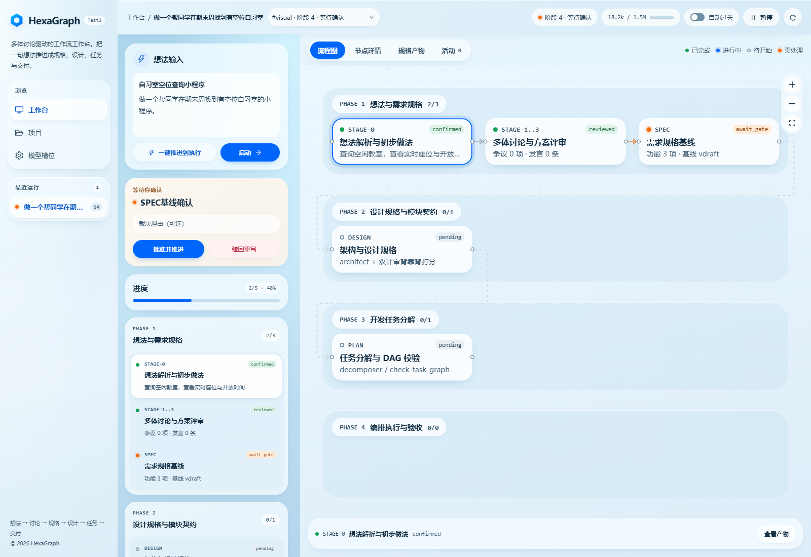
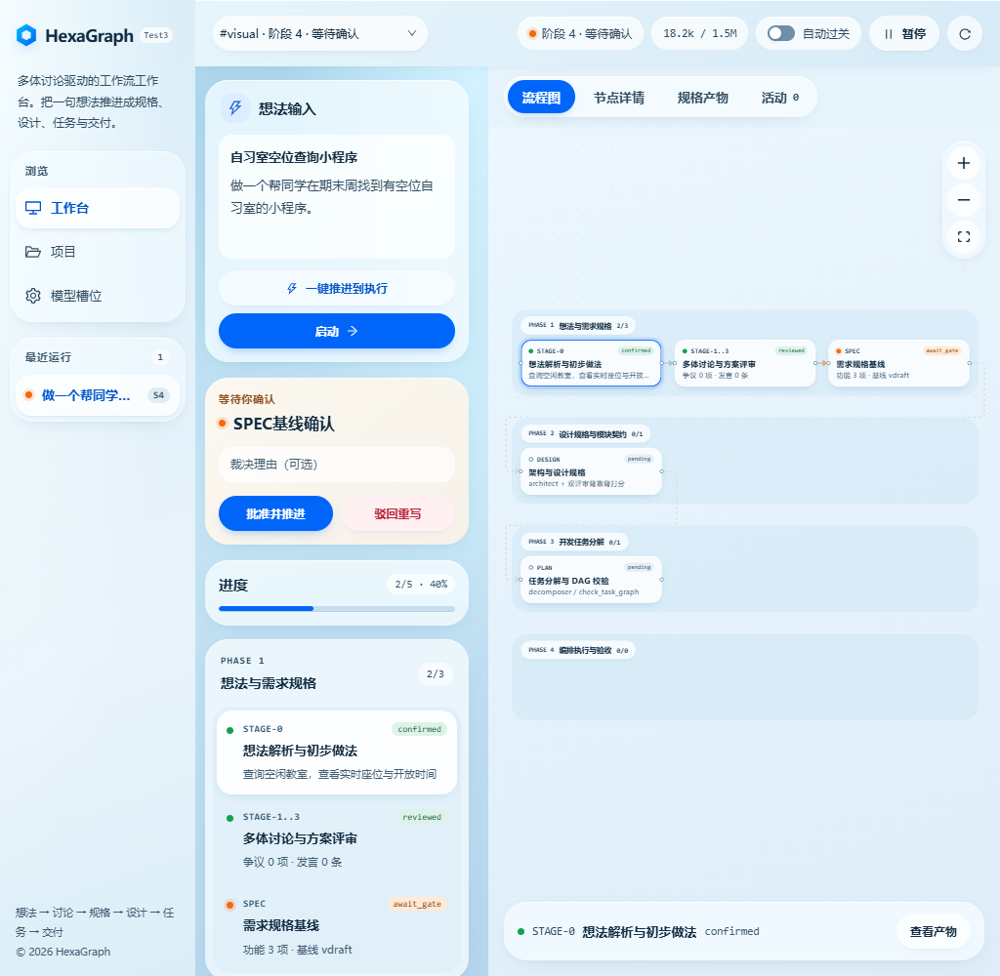

# HexaGraph UI 设计规范 · Ice Glass v1.4

版本：1.4 · 2026-11-18（北京时间）
适用：Test3 应用导航与整个 Workstation（左栏、顶栏、右侧标签、画布表面、详情、规格、活动、底部操作条），以及任务依赖图的共享边样式。
实现真源：`frontend/src/workstation-glass.css`、`frontend/src/flowEdgeStyle.ts`、`frontend/src/flowLayout.ts`、`frontend/src/workstationLayout.ts`、`frontend/src/workstationGraph.ts`、`App.tsx`、`pages/Workstation.tsx`。
过程与验证：[UI-Redesign-Log.md](UI-Redesign-Log.md)。

## 1. 设计目标与边界

风格关键词：冰蓝、轻盈、轻圆角、清晰分组、克制玻璃感。

老师参考图只用于校准“流程图优先、细边框、清晰连线、颜色区分状态”的克制层级，不复制其产品结构或文案。保留 HexaGraph 的工作流信息与全部现有功能。

v1.0 仅更新左侧两列；v1.1 推广到顶栏和右侧工作台；v1.2 加强共享边线；v1.3 做视觉减法：左栏改为单行进度列表，阶段用细分隔，节点与顶栏控件减重。React Flow 的节点坐标、布局算法、依赖关系和业务逻辑不变。项目、模型设置及独立运行详情路由不做全面重设计。

业务规则仍以仓库 Design / Architecture / ImplementationPlan 为准，本文件不定义状态机、API、审批或并发规则。

## 2. 视觉层级

1. 主视觉：右侧流程图优先，浅底、轻网格、细边节点和清晰关系线。
2. 左侧托盘：输入与确认保留，进度摘要不设独立厚卡；四个 PHASE 仅用细分隔。
3. 进度条目：状态点、编号、标题保持一行；不重复显示原始状态、角色和节点副文。
4. 活跃条目：轻白底，无厚描边和浮起阴影；节点副信息仅在 hover / 选中时显现，且预留尺寸不变。

玻璃感仅保留在必要的输入与导航表面。模糊是增强，不是可读性的前提；阶段容器和流程节点不再依赖大色块、厚描边或阴影建立层级。禁止为正文增加折射、色散、波纹或跟随鼠标变形。

## 3. 设计 token

下表统一定义在 `.shell`，由导航与 Workstation 继承；视觉组件仍通过 `.sidebar` / `.ws` 限定范围。`.ws` 内将旧 `--ink*` 角色映射到新文字色，以覆盖继承旧灰度的详情和状态。全局 `styles.css` 与 `theme.ts` 不直接替换，避免影响其它路由。

| 用途 | Token | 值 |
| --- | --- | --- |
| 主文字 | `--glass-ink` | `#122d42` |
| 次文字 | `--glass-secondary` | `#304b60` |
| 辅助文字 | `--glass-muted` | `#405c71` |
| 主操作 / 焦点 | `--glass-accent` | `#0066fa` |
| 卡片 | `--glass-surface` | `rgba(246,253,255,.78)` |
| 输入 / 活跃底 | `--glass-field` | `rgba(255,255,255,.72)` |
| 悬停底 | `--glass-hover` | `rgba(255,255,255,.62)` |
| 大模块圆角 | `--glass-radius-panel` | `24px` |
| 导航 / 条目圆角 | `--glass-radius-item` | `16px` |
| 输入圆角 | `--glass-radius-field` | `14px` |
| 模块间距 | `--glass-space` | `16px` |
| 轻层次阴影 | `--glass-shadow` | 柔和外阴影 + 顶部 1px 白高光 |
| 输入聚焦 | `--glass-focus` | `0 0 0 3px rgba(0,102,250,.25)` |
| 流程图主边 | `FLOW_EDGE_COLORS.default` | `#52738c`；2.5px 实线，18px 闭合箭头 |
| 流程图不适用边 | `FLOW_EDGE_COLORS.inactive` | `#718b9f`；2.25px 虚线，仍保持可见 |
| 流程图高亮边 | `FLOW_EDGE_COLORS.connected` | 复用品牌蓝 `#0066fa`；3px，20px 箭头 |
| 流程图淡化边 | `FLOW_EDGE_COLORS.dimmed` | `#a9bfce`；opacity 0.18，仅聚焦其它节点时使用 |

胶囊按钮与状态徽章圆角固定 `999px`。PHASE 内嵌列表圆角 `18px`。

需要新 token 时，先检查是否能复用现有角色。新增必须同步本表、组件说明与截图；不要不断追加近似蓝色和圆角。

## 4. 字体与间距

沿用 Funnel Sans / 系统中文字体回退；技术编号沿用 Geist Mono / 系统等宽字体。网络字体失败时布局必须仍可用，不依赖特定字体的精确字宽。

| 层级 | 字号 / 字重 | 规则 |
| --- | --- | --- |
| 品牌 | 19px / 650 | 窄屏 17px |
| 确认关卡标题 | 16px / 650 | 主操作区域的重点 |
| 模块标题 | 15px / 650 | 输入、进度 |
| PHASE 标题 | 14px / 650 | 独立一行，可换行 |
| 条目正文 | 13px / 600 | 可换行，不能被技术编号挤没 |
| PHASE / 技术编号 | 10px / 600 / 等宽 | 上层眉题或条目元信息 |
| 副文 | 11px / 400 | 1.6 行高，单行省略 + title 完整提示 |
| 原始状态 | 9px / 等宽 | 胶囊辅助信息，不承担正文标题职责 |

布局以 4px 为主节奏：内部 8 / 12 / 16px，模块之间 14–16px。标准卡片内边距 16px，窄屏 14px。不要在同一组里随意混用紧凑 4px 与宽松 24px。

## 5. 组件规则

### 应用导航

- `.nav-group` 形成“浏览”和“最近运行”两个轻玻璃分组。
- 导航至少 42px 高。活跃项使用白底 + 深蓝文字，不能只靠极细左边线识别。
- 最近运行保留状态点、想法摘要、阶段徽章和现有链接；摘要省略，徽章不能被挤压。
- 品牌、介绍、页脚不再靠连续水平细线切割。

### 想法输入

- `.composer.glass-panel` + `.panel-heading` + `.composer-fields` + `.composer-actions`。
- 输入共用浅色内嵌区域，不为每一个输入框叠黑描边。
- 标准按钮至少 36px 高；主要按钮纯蓝，次操作浅白底。
- “启动”和“一键推进到执行”分别保留原来的 mutation 参数；不得因为布局调整合并语义。
- 输入必须有稳定的 `aria-label`，placeholder 不是唯一的可访问名称。

### 等待确认

- `.gate-card` 使用浅暖杏色，和冰蓝背景区分。暖色表示“需要人工关注”，不是全局错误背景。
- 保留原关卡名称、补充想法输入、理由字段、loading 与 disabled 条件。
- “批准并推进”是主按钮，“驳回重写”是危险色次操作，不能换成相同视觉权重。
- 验收不通过时，“批准”必须继续要求理由；视觉改动不能取消这一限制。

### 进度与阶段

- `.progress-summary` 单独承载总进度数字和蓝色进度条。
- `.phase-list` 中每个 `.phase.glass-panel` 为一个独立模块。
- `.phase-head`：第一行 PHASE 编号，第二行中文阶段标题，右边计数胶囊。
- `.phase-items` 是内嵌分组底板，不添加外描边。
- 每条 `.row` 为原生 button：元信息行（code + 原始状态）→ 正文标题 → 副文。
- 选中状态用 `aria-pressed` 同步；支持 Tab 聚焦、Enter / Space 选择；不要改回仅绑定 click 的 div。
- 无条目显示“尚无条目”。0/0 仍表示尚未生成，不伪造完成率。
- 阶段名称、数据计算、选中后联动与右侧节点均保持原业务逻辑。

### 可拖分栏与分层图（v1.4）

- 中间信息栏与流程图之间是 8px 的 `role="separator"` 分栏条：指针拖动、键盘 ←/→（16px）、Shift+←/→（64px）、Home 复位；宽度 280–560px，画布不少于 480px，宽度与折叠状态保存在 `hexagraph.workstation.layout.v1`（不与静态课堂的存储键共用）。
- 画布不足 480px 时信息栏自动折叠；视口小于 1100px 时以抽屉形式覆盖，不挤压画布；Esc 关闭抽屉。
- 信息栏只保留一份“运行摘要 + 阶段总览条 + 一行状态”；重复的运行来源、DeepSeek 说明、规格原文与指纹默认折叠，原文与完整 sha256 仍在 DOM 中且可展开。
- 流程图由 `layoutLayered()`（`@dagrejs/dagre`）分层布局，节点固定 224×88，列间距随边数加大；长边使用车道直线穿过节点列、只在列间隙弯曲，反向边走节点下方通道，不穿过非端点节点。无依赖的节点进入下方网格。
- 主图只展示“当前”一张图：未到执行阶段显示模块图（边来自 `depends_on`，没有就不画）；执行阶段显示真实任务 DAG。不再伪造 S-PLAN 扇入；等待关卡使用琥珀色 `awaiting`，与红色 `error` 区分且保留文字。
- 视口只在结构变化或点击“重置视口”时适应；缩放不低于可读下限 0.6（左对齐），拖分栏、选中和悬停不触发重新适应；节点不可拖动、Handle 不可连线。


### 顶栏、右侧与浮动操作

- 顶栏为浅蓝玻璃带；历史运行 Select、状态与预算为胶囊。下拉浮层使用 `.glass-select-popup`，和触发器保持一致。
- 顶栏可换行，不能为保持单行而压小字体或遮挡操作；窄屏时右侧操作组自动折行。
- 工作台内 Ant Design Button 统一至少 36px 高、胶囊圆角、浅白次操作、纯蓝主操作；loading / disabled 语义不变。
- 自动过关使用带标签的原生 Switch 交互，Tab / Space 可用；刷新和暂停 / 恢复提供明确 aria-label。
- 标签页为浅白分段托盘 + 蓝色选中胶囊；选中态保留 `aria-pressed`。
- 缩放 / 适应画布按钮使用 34px 圆形按钮，外套浅色圆角托盘，不改变缩放逻辑。
- 画布用浅蓝底和弱点阵；PHASE 去斜线纹理，改半透明蓝底；节点为浅白圆角卡片。保持现有节点宽度、padding 和布局计算，选中节点继续使用蓝色焦点环。
- 阶段流程与任务依赖共用 `readableFlowEdge`：主关系使用蓝灰实线和同色的加粗闭合箭头，不使用边线动画；仅“不适用”路径使用虚线。选中或悬停节点时，直接前驱与后继边高亮，其余边淡化；不得改变节点坐标、依赖数据或点击行为。
- 节点编号、标题、说明、原始状态分别使用次文字、主文字、辅助文字和语义状态胶囊；不能继续使用低对比浅灰。
- 底部 dock 使用 24px 圆角玻璃面板；操作按钮、理由输入和禁用态沿用同一套控件。
- 详情、规格和活动区域沿用浅蓝页面底、浅白内容块、蓝灰文字；原数据内容不变。

### 文字清晰度

- v1.1 主文字加深到深海军蓝，说明文字使用有蓝调的深灰；避免全黑或冷浅灰破坏冰蓝风格。
- 正文和状态不使用 opacity 降低对比度；活动数量也不额外透明。
- 对比度抽检应基于透明底与背景混合后的最终颜色，不仅比较原始 rgba。
- 小字号状态只作辅助信息，不能用它替代节点正文。

### 状态语义

| 语义 | 表达 |
| --- | --- |
| 已完成 | 绿色圆点 + 浅绿状态底 / 深绿字 `#21643f` |
| 进行中 | 蓝色圆点 + 浅蓝状态底 / 深蓝字 `#0054b8` |
| 需处理 | 橙色圆点 + 浅橙状态底 / 深棕字 `#8d4513` |
| 待开始 | 空心灰蓝圆点 + 浅灰蓝状态底 / 深灰蓝字 `#466079` |

状态必须同时保留文字，不能仅靠颜色。原始 `rawState` 保留，不将后端状态重新映射成新的业务枚举。

## 6. 响应式与可访问性

- 运行栏宽度由分栏条决定（默认 320px，280–560px）；应用栏在窗口小于 1100px 时自动收起。
- 画布保持 ≥ 480px；不足时信息栏折叠，小于 1100px 用抽屉。页面无横向滚动。不是完整移动端重构；不要声称支持手机原生布局。
- 两列分别纵向滚动，保持 `min-height: 0` 与稳定滚动槽；禁止为了“全屏展示所有卡片”无限压缩字号。
- 标题和长 code 可以换行；副文可省略；按钮可换行，不能遮挡点击区域。
- 键盘焦点必须清晰；不要去掉 `:focus-visible`。
- 减少动效偏好下关闭两栏动画和过渡；减少透明度偏好下改用实体底色。
- 不支持 backdrop-filter 的浏览器使用默认浅色填充，功能不受影响。
- 本轮没有声称完成全面 WCAG 审计；新颜色与新交互应继续检查对比度、焦点、键盘与缩放。

## 7. 新增 UI 的标准结构

在运行栏内复用如下结构；其中标题、输入标签和操作必须根据真实功能命名，不为了展示增加无业务意义控件。

```tsx
<section className="my-panel glass-panel" aria-labelledby="my-panel-heading">
  <div className="panel-heading">
    <h2 id="my-panel-heading">模块标题</h2>
  </div>
  {/* 真实业务内容；内层使用 field/list 底色，避免重复描边 */}
</section>
```

```css
.ws-left .my-panel {
  padding: var(--glass-space);
  color: var(--glass-ink);
}
```

作用域以 `.ws-left` / `.sidebar` 或工作台内的 `.ws` 开头。共享 token 已提升至 `.shell`；不要在具体组件重复声明近似色值。Select 浮层通过专用 class 定位，不能污染其它页面弹层。推广其它路由仍需确认范围，不顺手覆盖全局 Ant Design token。

## 8. 每次修改的检查清单

- [ ] 无多重细线框；卡片靠填充与留白分组。
- [ ] 模块标题、PHASE、code、正文、副文和状态能快速区分。
- [ ] 复用 token，无随意新增色值与圆角。
- [ ] 空状态、长标题、长编号、多任务列表可用。
- [ ] 默认、悬停、选中、聚焦、禁用、加载状态均明确。
- [ ] 1600 / 1280 / 1024 / 768px 检查，没有面板内部横向溢出。
- [ ] 输入、启动、关卡批准/驳回、阶段选择、最近运行跳转正常。
- [ ] 顶栏暂停/恢复、历史选择、开关、四标签、缩放/适应画布、底部操作正常；工具栏无内部溢出。
- [ ] 不改 API、审批条件、状态机、运行计算和右侧图布局。
- [ ] TypeScript、生产构建、Vitest、浏览器回归通过。
- [ ] 更新本规范版本、修改记录与截图；注明模拟或真实后端。

## 9. 视觉基线

「项目主理人」沿用同一应用导航、Ice Glass 色板与确认卡片。左侧显示当前运行和确认点，右侧切换需求、计划、执行、经验与活动。甘特图用蓝灰表示普通任务、橙色表示依赖关键路径，任务条包含可访问名称，支持键盘选择后查看依赖和验收条件。

[项目主理人排期截图](screenshots/project-steward-schedule.png)来自预置模型和隔离后端的浏览器测试。

以下截图使用隔离的模拟 SPEC 关卡数据，不是生产运行记录。





流程图边可读性（1280×800，隔离 mock 数据）：

- [修改前阶段流程](screenshots/flow-edge-readability/before/stage-flow.png) / [修改后阶段流程](screenshots/flow-edge-readability/after/stage-flow.png)
- [修改后选中高亮](screenshots/flow-edge-readability/after/stage-flow-selected.png)
- [修改前任务依赖](screenshots/flow-edge-readability/before/task-dependencies.png) / [修改后任务依赖](screenshots/flow-edge-readability/after/task-dependencies.png)

视觉减法（1280×800，同一组隔离 mock 数据）：

- [修改前阶段流程](screenshots/visual-subtraction/before/stage-flow.png) / [修改后阶段流程](screenshots/visual-subtraction/after/stage-flow.png)
- [修改后选中高亮](screenshots/visual-subtraction/after/stage-flow-selected.png)
- [修改前任务依赖](screenshots/visual-subtraction/before/task-dependencies.png) / [修改后任务依赖](screenshots/visual-subtraction/after/task-dependencies.png)

## 10. 禁止的风格漂移

- 在每张卡片、每一行、每个输入上同时加 1px 深色描边。
- 全部文字同字号、同灰度，或把编号、原始状态、角色和副文全部堆回同一行。
- 每种状态做一整张高饱和卡片，和主操作争夺注意力。
- 给密集列表套连续多层模糊或高成本滤镜。
- 用图片、外部 UI 库或全新字体替代现有组件，只为增加装饰。
- 未经范围确认，把本次左栏视觉改动扩展到后端、路由或流程图布局。

分栏与分层图（v1.4，1440×900 等，隔离 mock 数据，未连接真实后端）：

- [修改前](screenshots/flow-layout/before/dag-1440x900.png) / [修改后](screenshots/flow-layout/after/dag-1440x900.png)
- [信息栏折叠](screenshots/flow-layout/after/dag-panel-collapsed-1440x900.png) / [信息栏加宽](screenshots/flow-layout/after/dag-panel-widened-1440x900.png)
- [设计关卡等待](screenshots/flow-layout/after/design-gate-1440x900.png) / [需补充输入](screenshots/flow-layout/after/needs-input-expanded-1440x900.png)
- [720px 抽屉](screenshots/flow-layout/after/narrow-drawer-open-720x760.png)
