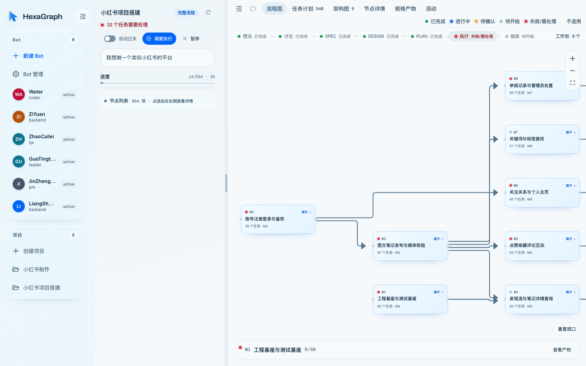
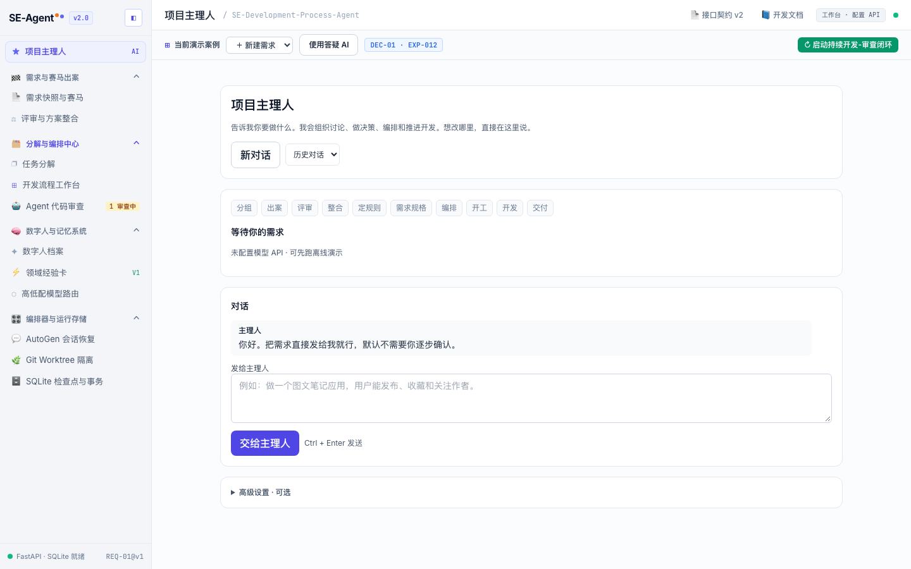
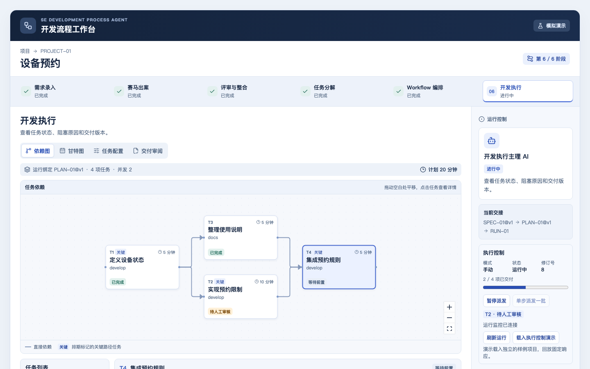

# HexaGraph Test3 × SE-Development-Process-Agent
## 差异评估与取舍建议（2026-11-25）

> 范围：只读评估。本轮没有修改源码或配置；启动后端时调度器向旧 run 追加了一条 `schedule.rejected` 事件（第 78 条），未改变任务状态。两边服务均已启动并截图。
> 关联文档：[逐项对比（原始版）](./comparison-with-se-process-agent-2026-11-25.md)。

## 0. 结论

**差距是真的，但它主要不在“功能多少”或“代码好坏”，而在“默认演示闭环”和“产品形态”。**

三个判断：

1. **第一眼差距来自演示状态，不是能力缺失。** 我们当前打开的是一条 540 任务的旧 run：6 个失败、26 个阻塞、508 个待执行；最新事件是 `schedule.rejected / profile_not_granted_v1`。对面的 React 演示（5173）默认是 4 个任务的 mock，6/6 阶段全绿、甘特图、交付审阅一应俱全。用户先看到的是“谁做完了”，不是“谁更深”。
2. **产品形态确实不同。** 对面是“项目主理人对话 + 阶段导航”，一句话推进；我们是“Bot/项目列表 + 图优先工作台”，信息密度高、操作点多。这不是简单的 UI 美丑，而是信息架构和目标用户不同。
3. **工程深度是反过来的。** 我们后端约 2.32 万行、测试约 2.32 万行、前端约 2.56 万行、88 条路由、36 张表；对面约 0.76 万行 Python、0.32 万行测试、0.50 万行 Web。按 2026-11-24 记录，我们后端 889 项、前端 427 项测试；对面 190 + 51。我们的审计、授权、证据、恢复明显更重，只是这些没有转化为十分钟内能看懂的演示。

**建议：不要为了“像对面”而重写。先做 A（演示闭环），再选做 C（深度差异化），B（全面产品形态对齐）暂缓。** 详细取舍见第 7 节。

---

## 1. 评估方法与证据

| 项目 | 内容 |
|---|---|
| 时间 | 2026-11-25 15:38–15:45（Asia/Shanghai） |
| 我们的服务 | 后端 `http://127.0.0.1:8765`，前端 `http://127.0.0.1:5174/workstation` |
| 对面的服务 | 主入口 `http://127.0.0.1:8008`；React v2 原型 `http://localhost:5173` |
| 截图 | [我们的 Workstation](./screenshots/gap-2026-11-25-test3-workstation.png)、[SE 主理人](./screenshots/gap-2026-11-25-se-steward.png)、[SE React 工作台](./screenshots/gap-2026-11-25-se-workbench.png) |
| 代码与数据 | 两边 README、docs、核心模块；我们的 `data/runs/09182750-.../snapshot.json` 与 `events.jsonl` |
| 未做 | 没有重跑两边全量测试；没有做安全渗透；没有修改任何源码 |

**一个必须先澄清的点：SE 有两张“皮”。**

- `8008` 才是它的主产品：`python -m se_agent.workbench` 启动，服务 `prototypes/se-development-process-agent-ui.html`（约 3,963 行、217 KB 的单文件页面）+ Python 标准库 + SQLite。默认入口是“项目主理人”对话，能走完整流程。
- `5173` 是 `web/workbench/` 的 React v2 原型，默认 `mockWorkbenchApi`，只覆盖部分 v2 接口；README 自己承认项目 GET 404 时会回退 mock。
- 我们的 `5174` 是唯一产品 UI，直接连真实后端。

所以：**拿我们的 Workstation 去比 SE 的 5173，是拿产品比原型；比 8008 才更接近“产品形态”的比较。** 但无论比哪张皮，第一眼的“完成度”差距都成立。

---

## 2. 两边到底是什么

| | HexaGraph Test3 | SE-Development-Process-Agent |
|---|---|---|
| 设计源 | 第一组 `Design.md`：讨论 → 方案 → 评审 → SPEC → DESIGN → PLAN → 执行 → 验收 | 第五组 QLM 工作台：需求赛马 → 评审整合 → 任务分解 → 编排 → 开发 → 交付 |
| 定位 | 6 人多体讨论 + 可审计的交付流水线 | 多智能体软件开发工作台，强调课堂演示闭环 |
| 主入口 | React Workstation + Twin Graph，项目/Bot 管理 | 8008 单文件 HTML 的“项目主理人”对话；5173 是 React v2 原型 |
| 默认执行 | 真实执行 + 授权闸；模拟执行需宿主注入策略 | 默认 mock；真实执行需绑定 Git 仓库 |
| 持久化 | SQLAlchemy/Alembic + JSONL/snapshot，36 张表 | 标准库 HTTP + SQLite Store，单进程 |
| 代码规模 | 后端 23,196 行、测试 23,182 行、前端 25,591 行、88 路由 | Python 7,567 行、测试 3,184 行、Web 4,970 行 |
| 测试 | 889 后端 + 427 前端（2026-11-24 记录），无 CI | 190 后端 + 51 前端，CI 只跑后端 unittest |
| 强项 | 盲评/交叉评审、三段门、哈希基线、授权/证据、恢复、测试深度 | 默认路径完整、甘特图、计划编辑、对话式控制、领域记忆、上手快 |

两句话概括：

- **SE 优化的是“评审者十分钟内相信这套东西能跑完”。**
- **我们优化的是“每一步都可审计、不假通过、出错能恢复”。**

这两个目标并不冲突，但默认界面和默认数据必须为前者服务，否则后者根本没人看见。

---

## 3. 现场证据：为什么“第一眼”差距大

### 3.1 我们的首页



截图里的信号：

- 图上有 **554 个节点**（含模块节点），UI 显示 **“32 个任务需要处理”**，进度 **14 / 554，3%**。
- 阶段条停在 **“执行 失败/需处理”**，`验收` 还是“待开始”。
- 左侧是 Bot 列表和项目列表，右侧是 Twin Graph；功能很多，但“下一步点哪”不明确。

对应磁盘数据（`data/runs/09182750-4271-5e8f-8228-7db27ffb26fd/snapshot.json`）：

| 字段 | 值 |
|---|---|
| 任务总数 | 540 |
| `pending` | 508 |
| `blocked` | 26 |
| `failed` | 6 |
| 审批门 | 1 个，已通过 |
| 执行 profile | `legacy` |
| 运行状态 | `waiting`，未暂停 |

`32 = 6 failed + 26 blocked`，与 UI 的“32 个任务需要处理”完全对上。

失败任务样例 `W1-01`：

```text
last_error / prev_output: 模型配置或凭据不可用
```

最新事件（`events.jsonl` 第 78 条）：

```text
kind: schedule.rejected
ts:   2026-11-25T07:38:38Z（北京时间 15:38:38）
payload.category: profile_not_granted_v1
detail: real execution requires granted_v1, an active grant, matching baselines
        and the server-owned safety gate; scripted model output alone does not
        authorize workspace writes, commands or merges
```

这条正好是本次启动后端时触发的。也就是说，**现在这条 run 同时卡在两处**：

1. **模型凭据**：`.env` 里是 `TEST3_LLM_PROVIDER=dashscope`，但没有 `DASHSCOPE_API_KEY`；这条 legacy run 的默认客户端直接报“模型配置或凭据不可用”。数据里虽然有带加密 key 的 Bot，但这条旧路径没有用上。
2. **执行授权**：`legacy` profile 在真实执行下必须 `granted_v1`；模拟执行器只能由宿主注入，不能从 HTTP/环境变量打开。默认 `create_app()` 没有注入，所以 403。

### 3.2 对面的首页



- 默认入口是“项目主理人”：一个对话框 + 一条阶段链（分组 → 出案 → 评审 → 整合 → 定规则 → 需求规格 → 编排 → 开工 → 开发 → 交付），右上角一个“启动持续开发-审查闭环”。
- 不需要先理解 Bot、图、写集、关卡；用户只需要说一句话。



- 5173 的 React 原型显示 **6/6 阶段**、需求/赛马/评审/分解/编排/执行全绿；4 个任务、20 分钟、甘特图、依赖图、交付审阅、运行控制。
- 它的底层默认是 mock，但**页面讲的是一个完整故事**。

### 3.3 结论

同一时间点的两张首页，传递的信号是：

- 对面：**“已经做完了，你可以点。”**
- 我们：**“出问题了，你需要处理 32 个任务。”**

这不是说我们的引擎更差；恰恰相反，我们是因为认真跑了 540 个任务、认真挡了未授权执行，才变成这样。但**演示不看动机，只看画面**。

---

## 4. 能力矩阵

图例：✅ 明显更强 / ⚠️ 有但弱或不可达 / ❌ 没有；最后一列是判断依据，不是评分。

| # | 维度 | SE | Test3 | 判断 |
|---|---|---|---|---|
| 1 | 默认启动 | 一条 `python -m ...`；无前端构建 | `make install` + 两个终端（uv/npm） | SE 更省事 |
| 2 | 默认端到端 | mock 走完 6 阶段，确认点默认关 | 真实执行被 403；模拟未接默认入口 | SE 明显更好 |
| 3 | 需求入口 | 主理人对话 + 表单 | 想法输入 + 项目页 | SE 更引导 |
| 4 | 多方案 | 2–5 组赛马，各组独立提示词 | 5 角色盲评、交叉互评、Leader 汇总 | Test3 机制更深 |
| 5 | 评审/决策 | 独立评价、融合、决策修订 | DecisionPackage、哈希、反对意见 | Test3 审计更强 |
| 6 | 规格 | 版本化 SPEC、未决项 | SPEC 审批、哈希基线、失效检测 | Test3 更严 |
| 7 | DESIGN | 无独立 DESIGN 阶段 | 独立 DESIGN + 评审门 | Test3 更完整 |
| 8 | 任务分解 | 分钟估时、任务编辑、依赖校验 | DAG、写集、点数、容量 600、每包 ≥50 叶子 | 目标不同，难直接比 |
| 9 | 计划可视化 | 甘特图、关键路径、连线、悬浮起止 | 无甘特图；关键路径只用于调度优先级，不展示 | SE 更适合讲故事 |
| 10 | 计划编辑/版本 | 保存即新版本，运行绑定版本 | `patch` 未实现；编辑走变更/重排 | SE 更好用 |
| 11 | 默认执行 | mock，明确标注“模拟” | legacy 真实执行被授权闸挡住 | SE 可演示 |
| 12 | 真实代码执行 | 可选绑仓库、worktree、commit 校验 | 执行器存在，但产品默认封锁 | SE 能演示，Test3 更安全 |
| 13 | 人工控制 | 对话式暂停/继续/重试/改需求 + 可选确认点 | 多类审批门 + 任务级 pause/resume/retry/skip/force-pass/takeover | Test3 更全，SE 更轻 |
| 14 | 验收/交付 | Docker 测试可选，交付指向任务分支 | 证据分级、验收报告、缺陷、回滚、release 导出 | Test3 更严 |
| 15 | 记忆/经验 | 领域记忆、经验卡、发布/撤销、复用 | 记忆记录、反馈聚类，缺自动复盘/经验卡 | SE 更产品化 |
| 16 | 审计/恢复 | SQLite 单进程，重启按租约恢复 | snapshot + JSONL、SSE/轮询、崩溃和解、事件溯源 | Test3 更深 |
| 17 | 安全边界 | 未见鉴权，固定本地 actor | 授权闸、哈希基线、HMAC、证据分级 | Test3 明显更强 |
| 18 | UI 易上手 | 阶段导航 + 对话，路径唯一 | 图优先、信息密度高、入口多 | SE 更容易 |
| 19 | 文档/启动 | README 约 6k 字，一条命令 | 文档很多，但入口分散、README 有过期承诺 | SE 更友好 |
| 20 | 测试/CI | 190 + 51，后端 CI | 889 + 427，无 CI | Test3 测试深，SE CI 完整 |

---

## 5. 差距是怎么来的

### 5.1 定义层：不是同一个产品

Test3 按第一组 `Design.md` 实现：**讨论质量、方案盲评、SPEC/DESIGN/PLAN 三段门、执行授权、证据分级**是核心卖点。

SE 按第五组 QLM 工作台实现：**赛马、评审整合、任务分解、甘特图、交付审阅、领域记忆**是核心卖点。

两边的阶段机、数据模型、默认交互都不同。要求 Test3“长成 SE”，本质上是在要求换一个产品定义，而不是修几个页面。

### 5.2 目标层：一个优化“可信”，一个优化“可见”

- 我们的代码里到处是“不能假通过”：空验收不能 done、写集越界不能 done、granted 才能真执行、证据分级、overridden 不冒充通过。
- 对面的代码里到处是“先让流程走完”：默认 mock、确认点默认关、未绑仓库返回模拟、交付时明确说明“本轮为模拟执行”。

前者在答辩时会被问“为什么点不动”，后者在代码评审时会被问“这是不是假的”。**两边都在为自己的目标付出代价，只是代价出现在不同的场合。**

### 5.3 状态层：旧数据把差距放大了

- 我们的默认数据是一条 540 任务的旧 run，6 个失败、26 个阻塞，还挂着 403。
- 对面的默认数据是 4 个任务的“设备预约”演示，6/6 全绿。

如果换成一条干净的 8–20 任务的小项目，我们的图也会很好看；但当前默认数据不是为演示准备的。**这是最容易修、收益最大的一层。**

### 5.4 包装层：单文件 HTML vs React 产品

SE 的主入口是一张 3,963 行的单文件 HTML，交互、样式、文案都在一个文件里，改起来快，讲故事也快。
我们是 React + Vite + Ant Design + React Flow，组件化更好，但入口、构建、状态都更重。

这不代表单文件更高级；它只说明**对面把“演示包装”当第一优先级**，我们把“工程质量”当第一优先级。两种选择都合理，但评估者通常先看到前者。

---

## 6. 哪些不是差距，别误判

1. **UI 不丑。** 我们的 Ice Glass 设计系统已经到 v1.33，有 token、有截图基线、有可访问性处理；问题在信息架构，不在视觉精度。
2. **后端不弱。** 2.32 万行、88 路由、36 表、889 测试，是 SE 的数倍；只是这些数字不会自己出现在首页。
3. **控制不少。** 任务级 pause/resume/retry/skip/force-pass/takeover、多类审批门、变更/反馈，SE 没有这么全。
4. **540 个任务不是优点也不是缺点。** 它说明我们在跑一个大项目；拿它和 SE 的 4 任务演示比“完成度”，不是同一把尺子。
5. **SE 的 React 5173 不是它的全部。** 拿它当基准会高估对面的产品完成度；真正的主产品在 8008。

---

## 7. 取舍：三条路线

| 路线 | 做什么 | 工期 | 收益 | 风险 | 适用场景 |
|---|---|---|---|---|---|
| **A. 演示闭环优先** | `make demo` + 模拟执行策略 + 明确标注 + 干净 demo 数据 + 修 README/403 文案 | 3–5 天 | 第一眼差距最快补齐；不动架构；保留安全边界 | 模拟执行可能被误读为“造假”，必须显著标注 | 课程答辩、组内评审、老师演示（**推荐先做**） |
| **B. 产品形态对齐** | 加“项目主理人”对话入口 + 阶段导航，把现有 API 包一层 | 2–3 周 | 最接近 SE 的观感 | 重复造轮子；掩盖 HexaGraph 的审计深度；对话到确定性 API 的映射成本高 | 评价标准明确要求“像 SE 一样对话式” |
| **C. 深度差异化** | 只读甘特图/关键路径、方案并排对比、验收后经验卡 | 1–2 周 | 强化“我们更深”的叙事；技术评审加分 | 如果评审只看首页，收益有限 | 技术评审、开源、后续迭代 |
| **D. A + 选择性 C** | 先 A，再从 C 选甘特图 + 方案对比 | 约 2 周 | 兼顾第一眼与深度 | 排期紧时需要砍范围 | **实际推荐组合** |

### 为什么推荐 A 先做

- 它不改变产品定义，不需要重写状态机，风险最低。
- 它直接解决“打开就是红的”这个最大减分项。
- 它能把我们已有的 889/427 测试、授权、证据、恢复能力“带出来”，而不是继续藏在代码里。
- 它只需要一个本地启动器，不需要把模拟执行暴露成 HTTP 或环境变量开关，安全边界不破。

### 为什么 B 暂缓

- 对话式主理人不是“加一个输入框”：它要处理意图识别、阶段推进、暂停/改需求/重规划、确认点、版本保留。SE 自己也是靠一套 `StewardPipeline` 和大量规则撑起来的。
- 如果只是做一个“看起来像”的聊天壳，底层仍然要落到确定性 API，投入不小，还容易把我们的强项（显式门、可审计）藏起来。
- 除非评价标准明确写着“必须像 SE 一样对话”，否则不建议先做。

---

## 8. 如果要做，具体怎么做

### P0：演示闭环（3–5 天）

1. **加本地 demo 启动器**
   - 新增 `scripts/demo_server.py`（或 `backend/app/demo.py`），调用
     `create_app(execution_policy=ExecutionPolicy(simulated=True))`。
   - `make demo` 一条命令启动；**不**通过 HTTP、`.env` 或环境变量暴露 `simulated` 开关。
   - 端口建议独立（如 8766），避免和日常开发的后端抢 8765。
2. **UI 明确标注“模拟执行”**
   - 顶部/运行条常驻标签：`模拟执行：不写仓库、不跑命令、不合并`。
   - 任务证据、验收报告、导出文件都标 `simulated`，不能显示成“真实通过”。
3. **修默认路径的两个断点**
   - 403 的 `profile_not_granted_v1`、`baseline_stale`、`needs_reconciliation` 等，在 `GrantStatusBanner` 给中文原因和下一步，不只弹英文 detail。
   - 更正 [README](../../README.md#L69) 里“默认 scripted 会走完 T-01/T-02”的过期承诺：scripted 不等于 simulated，真实执行仍需要授权或 demo 启动器。
4. **准备干净 demo 数据**
   - 一条小项目：1 个想法 → 讨论 → SPEC → DESIGN → PLAN（8–20 个任务）→ 模拟执行 → 验收导出。
   - 旧 run 归档/移出默认列表；不要让 540 任务、32 个红点成为第一眼。
5. **验收标准**
   - 干净 clone：`make install && make demo`，10–15 分钟内走到导出。
   - 全程没有 403、没有英文 detail、没有“点了没反应”。
   - 页面明确写“模拟执行”；README 与实际行为一致。

### P1：把深度可视化（约 1 周）

6. **只读甘特图 + 关键路径**
   - 后端只读暴露排期和 `critical_path`（已有纯函数），前端做时间轴；先不做编辑。
7. **讨论页方案并排对比**
   - 2–5 个方案的主张、评分、分歧、采用/融合，一屏可比较；数据已有。
8. **验收后经验卡**
   - 通过/导出时生成项目复盘，带测试与缺陷证据，发布到项目记忆；下一次计划注入并显示命中。

### P2：按需

9. **对话式命令条**：只做“暂停/继续/重试/改需求”的映射，底层仍走确定性接口，不做自由文本执行。
10. **CI**：后端 `pytest -m "not live"` + 前端 `npm test` + `npm run build`。
11. **计划编辑**：编辑生成新候选，走 `expected_revision` 和变更确认，不直接改已批准基线。

---

## 9. 汇报话术（3 分钟版）

**开场（30 秒）**

> 我们做的不是 SE 的克隆。SE 证明“流程可以很顺”，我们证明“流程可以很稳”：方案盲评、SPEC/DESIGN/PLAN 三段门、哈希基线、执行授权、证据分级、崩溃恢复。这些是我们比对面深的地方。

**演示顺序（2 分钟）**

1. 打开 Workstation：“这是图优先的工程工作台，左边是项目和 Bot，右边是完整流程。”
2. 展示讨论页：“5 个角色盲评 + 交叉互评，不是一组模型自说自话。”
3. 展示 SPEC/DESIGN/PLAN：“三段都有独立审批门和哈希基线，改一个字基线就失效。”
4. 展示任务图：“这是一个 540 任务的大项目；SE 的演示是 4 个任务，尺度不同。”
5. 展示执行监控/证据/导出：“失败不会假通过，证据分级，验收可导出。”
6. 诚实边界：“真实执行需要 granted_v1 授权；演示模式用模拟执行，不写仓库、不跑命令，页面会明确标注。”

**Q&A 预案**

- **“为什么不能直接跑真实代码？”** 这是安全设计：真实执行需要授权、基线匹配、服务器安全闸；演示模式单独启动，不伪装成真实执行。
- **“为什么有 540 个任务？”** 这是大项目；演示应该换一个小项目（8–20 任务）。任务多不是完成度，是尺度。
- **“为什么没有甘特图？”** 排期和关键路径已经在后端，前端还没可视化；这是 P1 的第一项。
- **“是不是照抄 SE？”** 不是。SE 是第五组 QLM 工作台，我们是第一组 HexaGraph 设计；可以参考它的演示包装，但不换我们的流程定义。

---

## 10. 反模式与风险

1. **不要为了绿灯删掉授权闸。** 那会把我们最大的差异点（安全/审计）换成对面已经有的东西。
2. **不要把 simulated 标成 real。** 证据、验收、导出必须带 `simulated` 标签；否则短期好看，长期失信。
3. **不要把 `simulated` 暴露成 HTTP/env 开关。** 只允许本地启动器注入；否则生产环境可能被误开。
4. **不要照搬 SE 的无鉴权/固定 actor。** 那是演示取舍，不是我们要补的能力。
5. **不要用 540 任务当默认 demo。** 默认数据要小、要绿、要能 15 分钟走完。
6. **不要让 README 超前于代码。** 每一条“默认能跑完”的承诺都要有对应测试或 demo 脚本。
7. **不要做“自由文本执行”的聊天入口。** 对话只能映射到确定性 API，不能绕过门和授权。

---

## 11. 附录

### A. 本次使用的命令

```bash
# 后端（Test3/backend）
.venv/bin/uvicorn app.main:app --host 127.0.0.1 --port 8765

# 前端（Test3/frontend；5173 被其它项目占用，所以用 5174）
npm run dev -- --host 127.0.0.1 --port 5174

# 健康检查
curl http://127.0.0.1:8765/api/health
curl http://127.0.0.1:5174/api/health

# 截图（Test3/frontend）
./node_modules/.bin/playwright screenshot --viewport-size="1440,900" \
  http://127.0.0.1:5174/workstation ../../.tmp-shots/test3-workstation.png
```

### B. 数据与文件

| 内容 | 路径 |
|---|---|
| 运行快照 | `Test3/data/runs/09182750-4271-5e8f-8228-7db27ffb26fd/snapshot.json` |
| 运行事件 | `Test3/data/runs/09182750-4271-5e8f-8228-7db27ffb26fd/events.jsonl`（第 78 条为 403） |
| 授权逻辑 | `Test3/backend/app/execution/authorization.py` |
| 运行策略 | `Test3/backend/app/execution/simulation.py` |
| 前端工作台 | `Test3/frontend/src/pages/project/ProjectWorkstationPage.tsx` |
| 前端路由 | `Test3/frontend/src/App.tsx` |
| SE 主入口 | `SE-Development-Process-Agent/se_agent/workbench.py` |
| SE 单文件页面 | `SE-Development-Process-Agent/prototypes/se-development-process-agent-ui.html` |
| SE React 原型 | `SE-Development-Process-Agent/web/workbench/src/App.tsx` |

### C. 指标口径

- 行数：`find ... -name '*.py' | xargs wc -l`、前端同理；含测试，不含 `node_modules`。
- 路由：`grep -rn "@router\.\(get\|post\|put\|patch\|delete\)" backend/app/api | wc -l`。
- 表：`grep -rn "__tablename__" backend/app | wc -l`。
- 测试数：889/427 来自 2026-11-24 的对比记录；190/51 来自 `grep def test_` 和 `it(`/`test(` 计数。
- 两边分支：我们 `feat/test3-agent-team-v1`；SE `main`。本地 remote-tracking 与 HEAD 当前一致（未重新 fetch）。

### D. 待团队确认的问题

1. 这次评价的标准是什么：看演示、看代码、还是看设计文档？不同标准对应不同路线。
2. 是否接受“模拟执行”作为默认演示，并在页面上明确标注？
3. 答辩前是否必须补甘特图？还是可以先用截图/讲稿代替？
4. 当前 540 任务的旧 run 是归档、隐藏，还是保留作为“大项目”证据？
5. 真实代码执行是否需要在现场演示？如果需要，必须先完成 grant/demo 启动器，否则只能演示受限路径。

---

**一句话收尾：**

> 我们不是比对面少做了功能，而是把“可信”做在了里面，把“可见”留在了外面。下一步不是重写，而是把里面已经有的东西，用一条不会断的演示路径端出来。