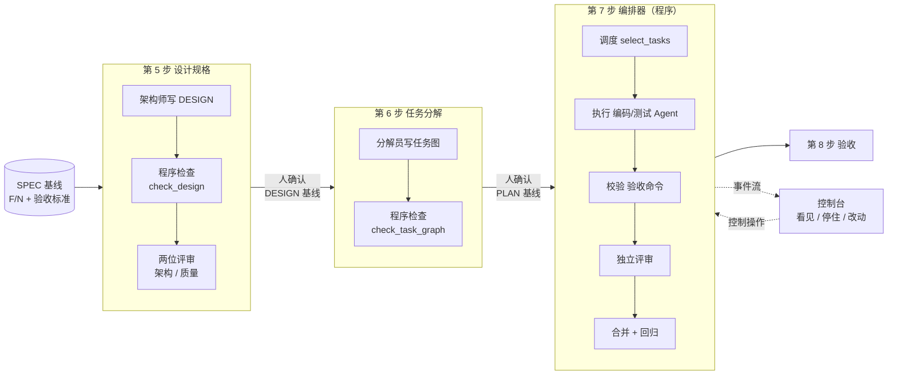
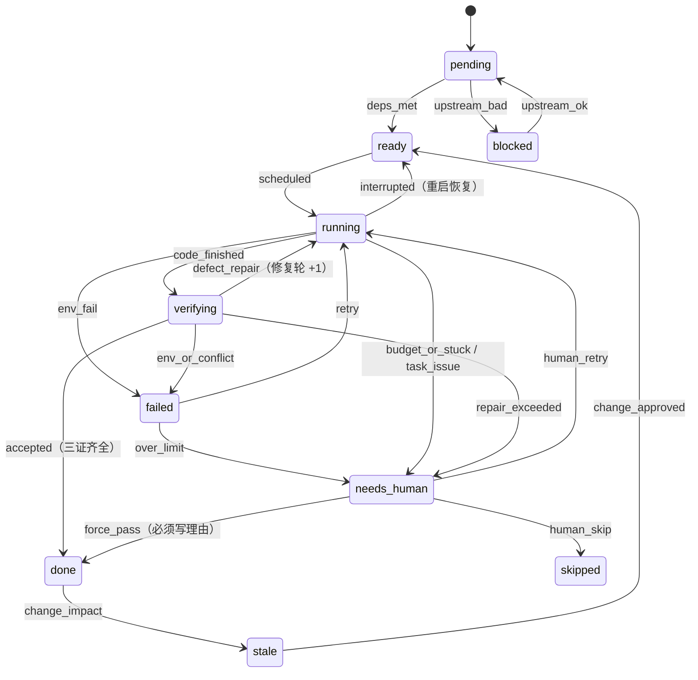
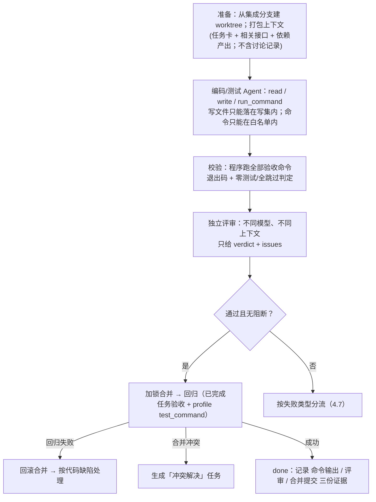

# 作业二：设计规格 → 任务分解 → 编排器 设计文档

> 课堂作业 2（流程设计）：设计规格 - 任务分解 - 编排器 -（执行可视化 / 执行交互）
> 课堂作业 2（设计验证）：完成上述设计的原型
>
> 项目：HexaGraph · 多体工作流工作台　　代码：`teamwork-001` 分支，`Test3/`
> 上游设计：`Design.md` 第 12–17 章、`Architecture.md`、`ImplementationPlan.md`（本文是这三份的「实现段」浓缩 + 验证剧本，不替代它们）

---

## 0 本文的定位与展示基调

### 0.1 这份文档回答什么

作业一把「想法 → 多体讨论 → 建设方案 → 多方评价 → 需求规格」走通了。作业二往后接：

```
需求规格(SPEC) → 设计规格(DESIGN) → 开发任务分解(PLAN) → 开发任务编排器 → 执行可视化与控制 → 验收交付
   第 4 步           第 5 步              第 6 步                第 7 步              第 16 章             第 8 步
```

本文只讲前面四块：**设计规格、任务分解、编排器、执行的可视化与控制**，并给出一个能在下周演示的完整例子（模拟输入 + 各阶段大致输出）。

### 0.2 基调：一句话和三条口径

**一句话：规则定流向，Agent 只在规则划定的范围内写作，完成必须有证据，人随时看得见、停得住、改得动。**

下周展示时统一用下面三条口径，避免讲成「又一个 Agent 套壳」：

| 口径 | 怎么说 | 代码里的体现 |
|---|---|---|
| **编排器是程序，不是 Agent** | 调度、状态流转、失败分类、重试上限全部是确定的纯函数，可复现、可测试；Agent 只出现在写设计、写任务、写代码、写测试、做评审五个位置 | `orchestrator/` 目录全是纯函数 + 数据表；没有用 LangGraph / AutoGen |
| **基线冻结，只能走变更** | SPEC / DESIGN / PLAN / BUILD 都是带版本号的基线，确认后不可悄悄改 | `_freeze()`、`baseline.frozen` 事件 |
| **运行时是多角色协作，不是多模型对打** | 不同角色（架构师、评审、编码、测试）分工，评审与被评审尽量分到不同模型槽位，是为了避免自评自赞，不是比谁的模型强 | `config/roles.yaml` 的 `slot` 字段 |

### 0.3 现状标记（全文通用）

| 标记 | 含义 |
|---|---|
| ✅ 已验证 | 本轮在 `teamwork-001` 上实际跑过命令，见第 6 章 |
| 🟡 已实现未联调 | 代码与单测在，但还没在前端或真实模型下点过 |
| ⏳ 待前端验证 | 要等前端接入后按第 8 章清单跑一遍 |
| ⚠️ 与设计有偏差 | 第 6.3 节集中列出，不藏 |

**一句话现状：** 后端从想法到验收的整条链在 `scripted`（脚本化模型）下已跑通并有自动化测试（94 项通过）；真实百炼模型和浏览器端到端还没验证，这正是下周展示和前端完成后要补的。

---

## 1 总体设计：三段流水线 + 两道门



**两道门**（每个 Agent 产物都要过）：

1. **程序门**：确定性检查，不由 Agent 判断（环、悬空依赖、写集重叠、覆盖、容量……）。
2. **人门**：关卡（gate）。SPEC / DESIGN / PLAN 三个基线必须由人批准后才冻结、才进入下一步。

**追溯链**由程序生成，不由 Agent 编写：

```
争议 I-xx → 功能/非功能 F/N → 模块 M → 接口 C → 任务 T-xx → 尝试 A-xx → 代码与测试 → 验收结果
```

每一环记录上游编号，变更时可沿链自动找出受影响部分（`Test3/backend/app/trace/service.py`，`GET /api/runs/{id}/trace`）。

---

## 2 第 5 步：设计规格

### 2.1 做什么、不做什么

| 做 | 不做 |
|---|---|
| 划分模块（职责、对外接口、依赖、持有数据） | 不写代码、不到类和函数级 |
| 写接口约定 C1、C2…（提供方、调用方、输入输出、错误） | 不引入 SPEC 里没有的功能 |
| 记录关键决策与风险；待定条目写成**有预案**的设计 | SPEC「本版不做」的内容，设计里也不做 |

**接口约定是任务分解的基础**：并行任务靠它对齐，而不是互相看对方的代码。

### 2.2 角色与模型槽位

| 角色 | 职责 | 槽位 | 约束 |
|---|---|---|---|
| `architect` 架构师 | SPEC → DESIGN | flagship | 只能用 SPEC 的功能/非功能与已采纳结论；不加新功能 |
| `review_arch` 架构评审 | 看结构、接口、过度设计 | flagship_alt | 与架构师不同厂商；看不到讨论记录 |
| `review_quality` 质量评审 | 看可测试性、可维护性 | flagship_alt | 同上 |
| `design_checker` 设计检查员 | 语义检查，只指问题不改 | flagship_alt | 角色已定义（见 6.3 偏差） |

槽位只是名字，实际模型在 `config/models.yaml` 里换，代码不写死模型名。

### 2.3 数据结构（`schemas/docs.py::DesignDoc`）

```text
DesignDoc
├─ chapters      固定七项：概述 / 模块 / 接口 / 数据 / 决策 / 预案 / 附录
├─ modules[]     code(M1..)、name、responsibility、sources[F/N/I]、provides[C..]、depends_on[M..]、data[]
├─ interfaces[]  code(C1..)、provider(M)、consumers[M]、inputs[]、outputs[]、errors[]
├─ data[]        核心数据对象
├─ decisions[]   选项 / 选择 / 理由 / 来源
├─ contingencies[]  待定条目的预案（I-03、I-04 …）
└─ appendix      追溯矩阵（由程序按 sources 生成）
```

### 2.4 设计检查（程序，`docs/checks.py::check_design`）

| 类别 | 检查项 | 失败时的提示（真实文案） |
|---|---|---|
| 形式 | 章节齐全 | `缺章节: …` |
| 形式 | 每个模块有来源 | `模块无来源: M?` |
| 形式 | 接口提供方/调用方存在且非空 | `接口提供方不存在` / `接口缺少调用方` / `接口调用方不存在` |
| 追溯 | 每个 P0/P1 功能至少有一个模块 | `F3 没有对应模块` |
| 追溯 | 每条待定/未讨论争议在第 6 章有预案 | `I-03 影响设计但第 6 章无预案` |
| 一致 | 模块数 ≤ 10（`config/limits.yaml: design.max_modules`） | `模块数 12 超过 10` |
| 一致 | 模块依赖无环 | `模块依赖成环: M1 -> M2 -> M1` |
| 一致 | 「本版不做」不出现在模块职责 | `本版不做内容出现在模块职责: …` |

### 2.5 评审与退回分流

两位评审背靠背 1–5 分打分，意见标明是否阻断。**通过规则**：平均分 ≥ 3.5，任一维度 ≥ 3，无阻断意见（`review_pass`）。不通过时按意见类型分流（`route_design_review`）：

| 意见类型 | 含义 | 去向 |
|---|---|---|
| 设计类 | 耦合过紧、接口缺字段 | 回架构师重写（含检查失败） |
| 需求类 | 发现 SPEC 自相矛盾、遗漏 | **不在设计里自行解决**，提交变更单 |
| 验证类 | 需要先做小实验才能判断 | 在任务分解里加「探索任务」先行 |

设计类退回最多 2 次（`design.max_rewrites`），仍不过则开「文档检查失败」关卡，由人手改。通过后开 **「DESIGN 基线确认」** 关卡，人批准即冻结为 DESIGN v1.0。

---

## 3 第 6 步：任务分解

### 3.1 目标

把 DESIGN 拆成一张**任务图**：节点是任务卡，边是依赖。要满足两条：**每个任务小到一个 Agent 一次能做完并验证；所有任务合起来覆盖全部 P0/P1 功能。**

### 3.2 任务卡（`schemas/docs.py::TaskCard`）

| 字段 | 含义 | 约束 |
|---|---|---|
| `code` | T-01… | 同一 run 内递增不重复 |
| `kind` | scaffold / stub / impl / test / integration / spike / doc | 契约先行：脚手架、接口桩、测试骨架在前 |
| `module` / `sources` | 所属模块；来源 F/N/C/M 编号 | **没有来源的任务不允许存在** |
| `write_set` | 允许创建/修改的文件或目录 | ≤ 8 个文件；越界写入被工具拒绝并记录 |
| `inputs` / `outputs` | 可读的接口与依赖产出；应出现的文件 | 输入引用必须指向**直接依赖**任务的产出（或 C 接口） |
| `acceptance[]` | 可运行命令 + 通过标准 + 来源验收标准 | 不能为空 |
| `depends_on` | 依赖任务 | 必须是 DAG |
| `points` | 故事点 | 只能是 1/2/3/5/8，**单任务 ≤ 8** |
| `priority` | P0/P1/P2 | 继承自功能 |
| `role` | `coder` / `tester` | 测试与实现分角色，避免自己出题自己做 |
| `budget` | 工具调用步数等 | 单任务令牌 = 点数 × 150 万 |

### 3.3 分解规则

1. **契约先行**：先脚手架 → 接口桩（按 C 生成签名）→ 测试骨架（按验收标准），实现任务依赖这三者。
2. **测试和实现分开**：测试任务由 `tester`（flagship_alt，与 coder 不同厂商）执行。
3. **写集不重叠才能并行**；有交叉必须加依赖。
4. **全覆盖**：每个 P0/P1 功能至少一个实现（impl/integration）任务和一个 test 任务。
5. **总量不超容量**：估算总和 ≤ 容量（默认 40 点）。
6. **探索任务先行**：来自评审「验证类」意见，产出是结论不是功能。

### 3.4 分解检查

| 层 | 检查 | 实现 |
|---|---|---|
| 程序（确定） | 无环、无悬空依赖、验收命令非空、点数 ≤ 8、写集文件 ≤ 8、来源存在、输入引用存在、P0/P1 有实现+测试任务、写集重叠须有依赖、总点数 ≤ 容量 | `check_task_graph`（✅ 单测） |
| 语义（Agent，只给意见） | 验收命令是否真能证明标准成立；描述是否清楚；是否漏依赖 | `graph_checker` 角色已定义，运行时尚未接线（见 6.3） |

不通过 → 问题清单交回分解员重写，最多 2 次；仍不过由人改。通过后看**关键路径与总点数**，确认后冻结 **PLAN v1.0**，编排器才开始执行。

---

## 4 第 7 步：开发任务编排器

### 4.1 职责与边界

编排器决定**任务何时、由谁、在什么条件下执行，失败后怎么办**；不决定做什么（任务内容来自 PLAN，改内容必须走局部重排或变更单）。它**是程序**，状态表、调度规则、失败分类都是数据与纯函数。

### 4.2 组成与代码对应

| 部件 | 职责 | 代码位置 |
|---|---|---|
| 计划加载 | 读 PLAN，为每个任务建运行记录，写追溯边 | `services/runtime.py::_materialize_tasks` |
| 调度器 | 按规则选出可开始的任务 | `orchestrator/scheduler.py::select_tasks` |
| 状态机 | 唯一允许改 `task.state` 的地方 | `orchestrator/states.py` + `transition.py::apply_transition` |
| 工作区管理 | 每个任务一个 git worktree / 分支 | `workspace/gitops.py` |
| 执行器 | 驱动一个任务走完循环，调工具型 Agent | `services/runtime.py::execute_task`、`tools/taskset.py` |
| 校验器 | 跑验收命令，判零测试/全跳过 | `orchestrator/validator.py::judge_output`、`tools/sandbox.py` |
| 集成器 | 加锁合并、跑回归、失败回滚 | `_accept_review_merge`、`_run_regression` |
| 失败分类 | 六类失败 + 失败特征值 | `orchestrator/classify.py` |
| 预算 | 点数 × 150 万；80% 告警 | `orchestrator/budget.py` |
| 控制 | 操作与状态可用性表 | `orchestrator/control.py` |
| 恢复 | 重启后重建状态、不重复合并 | `orchestrator/recovery.py` |
| 事件记录 | 只追加 JSONL + 原子 snapshot | `events/bus.py`、`Workbench.emit` |

### 4.3 任务状态机



要点：

- 转换表是**数据**（`TASK_TRANSITIONS`），表外的 `(状态, 事件)` 一律抛 `IllegalTransition` 并记 `orchestrator.illegal_transition`。
- 单测 `test_runtime_task_state_only_via_transition` 用正则扫 `runtime.py`，保证没人绕过状态机直接赋值。
- 其余终态/辅助转换（`skipped`、`cancelled`、合并冲突 → `blocked` 等）见 `states.py`。

### 4.4 调度规则（`select_tasks`，前面的优先）

1. 全局暂停 → 不派发。
2. 任务被单独暂停 / 锁定（人工接管）→ 不派发。
3. 依赖没有全部 `done`（或被跳过且允许下游继续）→ 不派发。
4. **写集与正在运行的任务重叠 → 不派发**（运行时再校验一次）。
5. 任务令牌预算耗尽 → 不派发（转 `needs_human`）。
6. 正在运行数 ≥ 并发上限（默认 6）→ 不派发。
7. 剩下的按排序键选：**关键路径剩余工作量大者优先 → P0 > P1 > P2 → 点数小者优先 → 编号小者优先**。

「合并冲突」生成的冲突解决任务（P0，写集 = 冲突文件）在 `schedule_once` 里**先于**普通任务调度。

### 4.5 单个任务的执行循环



### 4.6 完成条件（必须同时满足）

- 所有验收命令退出码为 0，且输出里**不是**「没有收集到测试 / 全部跳过」；
- 改动都在写集之内（越界 → `task.write_denied`，判任务描述问题）；
- 评审通过且无阻断意见；
- 合并成功且回归通过；
- 真的有文件产出（没有产出不能算完成）。

每项都落证据：`evidence = [command, review, merge]`。人手「强制通过」的证据标为 `manual` 并要写理由，验收报告里单列。

### 4.7 失败分类与处理（`orchestrator/classify.py`）

| 失败类型 | 判定信号 | 处理 | 计入修复轮 |
|---|---|---|---|
| 代码缺陷 | 验收命令非 0 或评审阻断 | 带 `prev_output` + `review_issues` 回到编码，最多 **6 轮** | 是 |
| 环境故障 | HTTP 429/5xx、超时、输出解析失败 | 指数退避重试最多 3 次，再换备用模型 | 否 |
| 任务描述问题 | **同一失败特征值连续两轮**；零测试 / 全跳过；验收命令被拒；写集越界；无产出 | 开「重排提案」关卡，等人确认 | 否 |
| 合并冲突 | merge 冲突 | 生成「冲突解决」任务，优先调度；它也失败则源任务转 `needs_human` | 否 |
| 依赖失败 | 上游 `needs_human` / `failed` / `skipped` | 下游置 `blocked`，不耗预算 | 否 |
| 预算耗尽 | 令牌超限 | 暂停该任务，转 `needs_human` | — |

**失败特征值**（`failure_signature`）：把失败输出里的时间、路径、行号、十六进制地址、耗时抹成 `<N>`，再取 SHA-256。连续两轮相同 = 没有进展，不再浪费修复轮，直接转重排。这是防「死循环修复」的核心。

### 4.8 局部重排

任务做不下去、又不是编码 Agent 能解决的，由任务分解员重新分解，**须人确认**才生效；新图要过与第 3.4 节相同的程序检查（`propose_replan` → `check_task_graph`），失败则返回 `replan_failed` 与错误清单。不能改接口约定与模块职责——必须改就说明问题在设计或需求，转变更单。

### 4.9 恢复与幂等

- 状态可由事件重建；进程重启后，原为 `running/verifying` 的任务：分支已合并 → 直接记完成；否则标 `interrupted` 回 `ready` 重新来，**不重复合并**（`recover_tasks`）。
- 合并时每个 run 一把 `asyncio.Lock`，包住「合并 + 回归 + 失败回滚」，并发任务不会互相抹掉。
- 5 秒调度兜底循环：只扫未暂停的活动运行，防止「没人点就卡住」。

### 4.10 预算与上限（`config/limits.yaml`，可按 run 覆盖并留痕）

| 项 | 默认 | 超限 |
|---|---|---|
| 并发任务数 | 6 | 排队 |
| 每任务修复轮 | 6 | `needs_human` |
| 环境故障重试 | 3 | 换备用模型，仍失败 `needs_human` |
| 每任务局部重排 | 1 | `needs_human`（见 6.3 偏差） |
| 单次尝试工具步数 | 30 | 该尝试结束，按缺陷处理 |
| 单任务令牌 | 点数 × 150 万 | 暂停并等人 |
| 整次运行令牌 | 2000 万（可调） | 暂停所有新任务；80% 时 `budget.warn` |
| 单次尝试耗时 | 600 秒 | 杀进程组，按环境故障 |

---

## 5 执行的可视化与控制（执行交互）

控制台**不改变编排规则**，只是规则的观察窗口和操作入口。

### 5.1 视图 ↔ 数据来源

| 视图 | 看什么 | 前端页面 | 后端接口 |
|---|---|---|---|
| 流程总览 | 第 0–8 步进度、基线版本、待我处理 | `Overview.tsx` | `GET /runs/{id}`、`/stages` |
| 待办列表 | 基线确认、`needs_human`、重排确认、变更决定、预算暂停 | `Todos.tsx` | `GET /runs/{id}/todos` |
| 任务图 | 节点按状态着色、边为依赖、关键路径高亮 | `Tasks.tsx`（`@xyflow/react`） | `GET /runs/{id}/tasks` |
| 任务详情 | 任务卡、尝试、工具调用、验收输出、评审、证据 | `Tasks.tsx` | `GET /tasks/{id}` |
| 事件时间线 | 所有事件按时间追加，含我的操作 | `Timeline.tsx` | `GET /runs/{id}/events`（SSE）、`/events/history` |
| 预算看板 | 总预算/任务预算、80% 告警 | `Budget.tsx` | `GET /runs/{id}/budget` |
| 追溯视图 | I → F → M → C → T → 验收 | （文档页 / API） | `GET /runs/{id}/trace`、`/trace/impact` |

### 5.2 控制操作与可用状态（`orchestrator/control.py`，前后端同表）

| 操作 | 可用状态 | 约束 |
|---|---|---|
| 全局暂停 / 继续 | 整个运行 | 暂停只在安全点生效，不强杀进行中的模型调用 |
| 终止运行 | 整个运行 | 必须 `confirm=true`（前端二次确认） |
| 暂停 / 继续任务 | 非终态 | — |
| 重试 | `needs_human`、`failed` | 新开尝试，可附提示 |
| 跳过 | 非终态 | **必须写理由**；可选下游继续或保持 blocked |
| 人工接管 / 提交接管结果 | 非终态 | 锁定任务；提交后走**同样**的验收、评审、合并 |
| 强制通过 | `needs_human`、`failed` | **必须写理由**；证据标「人工通过」；集成回归失败时不允许 |
| 调整并发与预算 | 整个运行 | 只对之后的调度生效，写 `system.limit_changed` |

**控制语义：** 留痕（每个操作一条事件）；**乐观锁**（带 `expected_revision`，状态变了返回 409 让你刷新）；暂停不是强杀；可恢复（刷新页面从事件重建）。

---

## 6 设计验证：原型现状

### 6.1 设计 → 代码对照

| 设计章节 | 原型实现 | 状态 |
|---|---|---|
| 第 5 步 设计规格 | `run_design`、`check_design`、`route_design_review`、`review_pass` | ✅ |
| 第 6 步 任务分解 | `run_plan`、`check_task_graph`、`critical_path` | ✅ |
| 第 7 步 编排器 | `schedule_once`、`select_tasks`、`execute_task`、状态机、分类、预算、恢复 | ✅ |
| 第 16 章 控制 | `control_task`、`set_run_control`、乐观锁、todos、预算、SSE | 🟡 |
| 前端页面 | `frontend/src/pages/*.tsx`（项目、总览、讨论、文档、任务、时间线、待办、预算、变更、设置） | ⏳ |

### 6.2 本轮实测证据

在 `teamwork-001`（`8cde8bf`）的 `Test3/backend` 上实际执行：

```text
$ uv run pytest -q -m "not live"
# 94 passed

# 同一夹具（自习室，scripted）从想法一路走到验收，事件摘录：
关卡顺序: 初步做法确认 → 争议清单查看与裁决 → 评审确认 → SPEC基线确认 → DESIGN基线确认 → PLAN基线确认 → executing
设计评审: 架构一致性 4 分 / 实现质量 4 分 → review_pass = True
#31 T-01 pending   --deps_met-->  ready
#32 T-01 ready     --scheduled--> running
#33 T-01 running   --code_finished--> verifying
#34 T-01 verifying --accepted-->  done        证据: command / review / merge
#35..#38 T-02 同样走完
当前阶段: 7 → 全部任务 done 后进入阶段 8，生成验收报告（F1/F2/F3 通过，追溯矩阵 I→F→M→T 已生成）
```

另有一次**程序检查实测**：用本文第 7 章的示例 DESIGN（6 模块、3 接口）和 9 任务图直接喂给 `check_design` / `check_task_graph`，两者都返回空错误列表；关键路径为 `T-01 → T-02 → T-03 → T-04 → T-08`，总 22 点；`T-03` 完成后调度器在并发 6 下同时选出 `T-04 T-05 T-06 T-07 T-09`，并发降到 2 时只选 `T-04 T-05`（按剩余工作量排序）。

### 6.3 已知局限与偏差（展示时主动说）

| # | 设计 | 现状 | 影响与计划 |
|---|---|---|---|
| 1 | 设计检查员、分解检查员、估算（Planning Poker）由 Agent 做语义检查 | 角色与提示词在，运行时只接了**程序检查**；估算点数直接由分解员给 | 「验收命令是否真能证明标准成立」目前没有语义兜底；真联调后接线 |
| 2 | 评审判定「任务描述有问题」→ 转重排 | `classify` 支持，但评审输出里没有这个字段；当前由**程序可判定的信号**触发（同特征值两轮、零测试、写集越界等） | 展示剧本用「验收命令指向不存在的测试文件」触发，真实可复现 |
| 3 | 局部重排只动受影响的任务及其下游，同任务最多 1 次 | `_apply_replan` 会**取消所有未完成任务**，按新图重建；未强制「最多 1 次」 | 展示时选在多数任务已完成时触发；后续改为子图重排 |
| 4 | 设计评审「验证类」意见 → 自动在分解里加探索任务 | `route_design_review` 返回「探索任务」，运行时目前只开「文档检查失败」关卡让人处理，不会自动插入探索任务 | 展示里 T-09 由分解员直接给出 |
| 5 | 控制：修改任务卡（patch） | 明确拒绝 `patch` | 展示不用 |
| 6 | 运行态进 SQLite 事件表 | 目前 JSONL + 原子 snapshot，可重启恢复；SQLite 表仅单测使用 | 不影响演示 |
| 7 | 默认走真实百炼 | 默认 `scripted`，避免空密钥外呼；`make check-models` / `test-live` 未跑 | 真实模型联调是下一步 |
| 8 | 前端浏览器端到端 | 只跑了 vitest（控制按钮可用状态）；未做 Playwright | 前端完成后按第 8 章逐项验证 |

---

## 7 演示示例：自习室小程序

> 说明：下面是**展示用的模拟输入 + 大致输出**。结构、字段、状态流转与代码一致；**数字（令牌数、耗时、提交号）是示意值**，以实际运行为准。第 6.2 节的实测证据对应其中「最小闭环」部分。

### 7.1 输入

只有一句话（`Test3/examples/study-room/idea.txt`）：

```text
做一个帮同学在期末周找到有空位自习室的小程序。
```

用 API 表示（前端「新建项目 → 提交想法」就是调这两个）：

```http
POST /api/projects
{"name": "自习室小程序", "profile": "python-pytest"}

POST /api/projects/{project_id}/runs
{"idea": "做一个帮同学在期末周找到有空位自习室的小程序。"}
```

环境（`.env`）：`TEST3_LLM_PROVIDER=scripted`（本机演示）或 `dashscope`（真联调），`TEST3_SCRIPTED_FIXTURE=study-room`。

### 7.2 上游产物（作业一已走通，作为本文输入）

**争议清单**（讨论结束后）：

| 编号 | 内容 | 状态 | 去向 |
|---|---|---|---|
| I-01 | 接入门禁数据 | 采纳 | 本版不做 |
| I-02 | 保存剩余座位数与上报时间，超 30 分钟标灰 | 采纳 | 功能 / 验收标准 |
| I-03 | 同学愿不愿意主动上报 | **待定**（需真人验证） | 风险与待定 + 预案 |
| I-04 | 相对群聊有没有优势 | **待定** | 风险与待定 + 预案 |
| I-05 | 查看免登录，上报需登录 | 采纳 | 功能 |
| I-06 | 同一账号 10 分钟内限一次上报 | 采纳 | 功能 / 验收标准 |
| I-07 | 多栋楼支持 | 采纳 | 本版不做 |

**SPEC v1.0（摘要）**：

| 编号 | 功能 | 优先级 | 验收标准 | 来源 |
|---|---|---|---|---|
| F1 | 按楼栋/楼层查看剩余座位 | P0 | 能看到座位数和上报时间 | 初步做法、I-02、I-05 |
| F2 | 上报剩余座位 | P0 | 同一账号 10 分钟内第二次上报被拒绝 | 初步做法、I-06 |
| F3 | 收藏教室 | P1 | 收藏后下次打开置顶（**人工检查项**） | 初步做法 |

第 4 章「还没定的问题」：I-03、I-04。本版不做：门禁数据接入（I-01）、多栋楼（I-07）。

### 7.3 第 5 步输出：DESIGN v1.0（摘要）

**第一版有一处故意留的缺口**（演示「程序检查 → 退回重写」）：架构师第一稿只出 M1–M5，没有收藏模块。

```text
check_design → ["F3 没有对应模块"]
→ 架构师带着错误清单重写（第 1 次，上限 2 次）→ 补上 M6 → check_design → []
```

**模块**（≤ 10）：

| 模块 | 名称 | 职责 | 来源 | 提供接口 | 依赖 |
|---|---|---|---|---|---|
| M1 | 查询服务 | 按楼栋返回教室与剩余座位 | F1 | C1 | M4 |
| M2 | 上报服务 | 接收上报并限频 | F2（I-06） | C2 | M3、M4 |
| M3 | 账号与登录 | 查看免登录，上报需登录 | F2（I-05） | — | — |
| M4 | 教室与座位数据 | 保存座位数与上报时间；超 30 分钟标灰 | F1（I-02） | — | — |
| M5 | 小程序界面 | 页面与调用适配 | F1、F3 | — | M1、M2、M6 |
| M6 | 收藏 | 收藏教室并置顶 | F3 | C3 | M4 |

没有「门禁数据接入」模块（I-01 去向是本版不做）。

**接口约定**：

| 接口 | 提供方 → 调用方 | 说明 | 错误 |
|---|---|---|---|
| C1 | M1 → M5 | 查询某栋楼的教室列表（含座位数、上报时间、是否标灰） | — |
| C2 | M2 → M5 | 提交一次上报（楼栋、教室、座位数） | `10 分钟内重复上报`、`未登录` |
| C3 | M6 → M5 | 收藏 / 取消收藏 / 取收藏列表 | — |

**第 6 章预案**：I-03 → 「上报提醒」，由探索任务 T-09 先验证可行方式；I-04 → 试点两周统计上报条数，偏少则改为固定时段推送。

**设计评审**：架构评审 4 分、质量评审 4 分，无阻断意见 → 通过 → 开「DESIGN 基线确认」关卡，**我批准** → DESIGN v1.0 冻结。

### 7.4 第 6 步输出：PLAN v1.0

```text
check_task_graph → []        # 总点数 22 ≤ 容量 40；无环；写集无冲突；P0/P1 均有实现+测试任务
关键路径: T-01 → T-02 → T-03 → T-04 → T-08   (2+2+3+3+3 = 13 点)
```

| 任务 | 标题 | 类型 | 角色 | 来源 | 依赖 | 点 | 优先级 | 写集 |
|---|---|---|---|---|---|---|---|---|
| T-01 | 项目脚手架 | scaffold | coder | M4 | — | 2 | P0 | `pyproject.toml` `src/models.py` |
| T-02 | 按 C1–C3 生成接口桩 | stub | coder | C1 C2 C3 | T-01 | 2 | P0 | `src/contracts.py` |
| T-03 | 按验收标准写测试骨架 | test | **tester** | F1 F2 F3 | T-02 | 3 | P0 | `tests/test_query.py` `tests/test_report.py` `tests/test_favorite.py` |
| T-04 | 实现上报限频 | impl | coder | F2 C2 | T-03 | 3 | P0 | `src/report.py` |
| T-05 | 实现查询与超 30 分钟标灰 | impl | coder | F1 C1 | T-03 | 3 | P0 | `src/seats.py` |
| T-06 | 实现账号与登录 | impl | coder | F2 M3 | T-03 | 2 | P0 | `src/auth.py` |
| T-07 | 实现收藏与置顶 | impl | coder | F3 C3 | T-03 | 2 | P1 | `src/favorites.py` |
| T-08 | 小程序接口适配层 | integration | coder | F1 F3 | T-04 T-05 T-06 T-07 | 3 | P0 | `src/gateway.py` `tests/test_gateway.py` |
| T-09 | 探索：上报提醒的可行方式 | spike | coder | M2 | T-02 | 2 | P2 | `docs/spike-reminder.md` `tests/test_spike_reminder.py` |

任务卡示例（T-04，字段与 `TaskCard` 一致）：

```json
{
  "code": "T-04",
  "title": "实现上报限频",
  "kind": "impl",
  "module": "M2",
  "sources": ["F2", "C2"],
  "description": "按 C2 实现上报；同一账号 10 分钟内第二次上报返回错误「10 分钟内重复上报」。不写 UI。",
  "inputs": ["C2", "tests/test_report.py"],
  "write_set": ["src/report.py"],
  "outputs": ["src/report.py"],
  "acceptance": [
    {"cmd": ["python", "-m", "pytest", "tests/test_report.py", "-q"],
     "pass_criteria": "退出码 0 且至少收集 1 个用例",
     "from_criterion": "F2"}
  ],
  "depends_on": ["T-03"],
  "points": 3,
  "priority": "P0",
  "role": "coder"
}
```

我在控制台看依赖、关键路径、总点数后**批准** → PLAN v1.0 冻结，编排器开始执行。

### 7.5 第 7 步输出：编排器运行剧本

这一段是**展示主线**。剧本里预置两个「真实可复现」的事件，用来证明编排器不是顺序跑脚本：

- **事件 A（代码缺陷 → 修复轮）**：T-04 第一次尝试里，测试里时间被固定，而限频用了本地时间，验收命令失败。
- **事件 B（任务描述问题 → 重排）**：T-05 的初版验收命令写成 `pytest tests/test_seats.py`，但 T-03 产出的是 `tests/test_query.py`，命令跑出「no tests ran」→ 零测试 → 判任务描述问题。

示意时间线（`#` 为事件序号，与「事件时间线」页对应）：

```text
#30  gate.resolved      PLAN基线确认 approve        → baseline.frozen PLAN 1.0；物化 9 个任务
#31  T-01 pending→ready                            （只有 T-01 无依赖）
#32  T-01 ready→running   coder  尝试 A-01
#33  T-01 running→verifying   验收: pytest tests/test_smoke.py  → 1 passed
#34  T-01 verifying→done      证据: command ✓ review ✓ merge 3f9a…   ← 回归通过
…    T-02 同样 done；T-03(tester) 与 T-09(spike) 并行（T-03 剩余 9 点，T-09 剩余 2 点）
#52  T-03 done  →  T-04 T-05 T-06 T-07 同时 ready
#53  调度: 并发 6，选出 T-04(6) T-05(6) T-06(5) T-07(5)      # 括号 = 关键路径剩余点数
     四个任务各自一个 worktree，写集两两不重叠 → 同时 running

—— 事件 A ——
#61  T-04 running→verifying   验收: pytest tests/test_report.py → exit 1
     AssertionError: 第二次上报应被拒绝            失败特征值 sig=9c1e…
#62  classify → 代码缺陷；repair_rounds=1（上限 6）
#63  T-04 verifying→running   下一轮输入 = 任务卡 + prev_output + review_issues
#68  T-04 verifying→done      第 2 次尝试通过；评审 pass；merge 7b02…；回归通过

—— 事件 B ——
#64  T-05 running→verifying   验收: pytest tests/test_seats.py → exit 4, "no tests ran"
#65  classify → 任务描述问题（零测试）；T-05 verifying→needs_human
#66  gate.created  重排提案 {task: T-05, kind: 任务描述问题}      ← 出现在「待办列表」
#70  我在控制台批准重排 → 分解员重写 → check_task_graph → []
     新 T-05 验收改为 pytest tests/test_query.py -q
     （当前实现：未完成任务取消并按新图重建，T-01…T-04 已 done 保留）

—— 控制 ——
#73  我点「全局暂停」：不再派发新任务，进行中的尝试跑完当前步后停下   （control.pause，带操作者与版本号）
#74  预算看板显示 T-09 令牌偏高 → 调低其预算 → system.limit_changed
#75  继续

#9x  T-05 / T-06 / T-07 done → T-08 ready → running → done
#9y  maybe_tasks_complete → 阶段 7 → 8（tasks_complete）
```

**此时任务图页应看到**：9 个节点全绿（`done`）；T-05 的详情里有两次尝试，第一次红（零测试）；T-04 有两次尝试，第一次红（代码缺陷）；关键路径 `T-01→T-02→T-03→T-04→T-08` 高亮。

### 7.6 第 8 步输出：验收报告（摘要）

| 功能 | 优先级 | 结果 | 证据 | 对应任务 |
|---|---|---|---|---|
| F1 按楼栋/楼层查看剩余座位 | P0 | 通过 | `accept-*.log` | T-03、T-05、T-08 |
| F2 上报剩余座位 | P0 | 通过 | 同上 | T-03、T-04、T-06 |
| F3 收藏教室 | P1 | 通过（自动部分）；「收藏后置顶」为**人工检查项**，待我确认 | 同上 | T-03、T-07、T-08 |

- 待定条目：I-03、I-04 报告写明「需要试点验证」。
- 追溯矩阵（程序生成）：`I-02 → F1 → M1/M4 → T-05 → tests/test_query.py` 等。
- 我确认后：打标签 `build-1.0`，导出 `data/runs/<id>/release/`（`code/` + `trace.json`）。

### 7.7 （选演）变更：CR-01

后勤代表希望扫二维码直接打开某间教室的页面 → 提变更单 CR-01。程序分析：影响 F1、M1、M5，涉及 2 个模块，不动 P0 范围 → **小变更**；已完成的 T-05 因界面入口变化被标 `stale`；三位评估者给 4、4、3 分，无阻断 → 我批准 → SPEC / DESIGN / PLAN 同升 v1.1，未受影响条目逐字相同，编排器重做 T-05 并加入新任务。（`done --change_impact--> stale --change_approved--> ready`）

---

## 8 前端接入后的验证清单（下周展示用）

前端完成后，按这张表逐项在浏览器里点一遍。**每项都有后端对应动作和通过标准**，打勾即证明工作流跑通。

| # | 验证项 | 操作 | 通过标准 |
|---|---|---|---|
| V1 | 起得来 | `make dev-backend` + `make dev-frontend`；`GET /api/health` | `{"status":"ok"}`，页面能打开 |
| V2 | 建项目与想法 | 项目页新建，提交 7.1 的那句话 | 总览出现「初步做法确认」待办 |
| V3 | 走到 SPEC | 依次批准：初步做法 → 争议清单 → 评审 | 讨论页 14 条发言、7 条争议（I-03/04 待定）；文档页 F1–F3 |
| V4 | **设计规格** | 批准 SPEC | 文档页出现 DESIGN：6 模块、3 接口；时间线有一次 `check_design` 失败后重写（若夹具含此剧本）；评审 4/4 分；出现「DESIGN 基线确认」 |
| V5 | **任务分解** | 批准 DESIGN | 任务页出现 9 个节点和依赖边；关键路径 `T-01→T-02→T-03→T-04→T-08` 高亮；总点数 22；出现「PLAN 基线确认」 |
| V6 | **编排并行** | 批准 PLAN，触发调度 | T-03 完成后 T-04–T-07 同时 `running`；写集有重叠的不会同时跑 |
| V7 | 修复轮 | 观察事件 A | T-04 先红后绿；详情页看得到两次尝试和失败输出 |
| V8 | 重排 | 观察事件 B | 「待办」出现重排提案；批准后任务图更新；T-05 最终 done |
| V9 | **控制** | 全局暂停 / 继续；对某任务暂停、跳过（不写理由应被拒） | 暂停后不再有新任务 `running`；缺理由返回 400；操作出现在时间线 |
| V10 | 乐观锁 | 两个页面同时操作同一任务 | 后一个返回 409，提示刷新 |
| V11 | 强制通过 / 接管（选演） | 对 `needs_human` 任务强制通过并写理由；或接管 → 提交接管结果 | 证据标「人工通过」；接管提交后仍走验收、评审、合并 |
| V12 | 预算 | 调低某任务预算 | `budget.warn`/`budget.exceeded` 出现，任务转 `needs_human` |
| V13 | 刷新与重启 | 刷新页面；重启后端 | 控制台状态从事件恢复；`running` 的任务变 `interrupted` 后重来，已合并的不重复合并 |
| V14 | 验收与交付 | 全部 done 后验收，批准 | 验收报告 F1–F3；`build-1.0` 标签；`release/` 导出 |
| V15 | 真实模型（加分） | 设 `DASHSCOPE_API_KEY`，`make check-models`，provider 切 `dashscope` | 至少设计 + 分解两步在真模型下过程序检查 |

**当前夹具说明：** `scripted` 的 `study-room` 夹具现已覆盖「想法 → … → 2 个任务 → 验收」的最小闭环（✅）；第 7 章的 6 模块 / 9 任务 / 事件 A、B 是展示剧本，需要在夹具里补对应 scripted 项（或用 `replay`、`dashscope` 跑）——这是前端接入前后要补的一项具体工作，不影响设计成立。

---

## 9 扩展考虑（与课堂提示对应，非本次必须）

| 方向 | 现状与思路 |
|---|---|
| **需求变更流程设计** | 已有：变更单 → 分级与影响分析 → 三位评估者 → 人决定 → 增量重写并升版本（`submit_cr` / `decide_cr`，Design 第 18 章）；本文 7.7 为示例 |
| **开发任务编排器详细设计** | 本文第 4 章；后续：局部重排改为子图重排、重排次数硬限制、评审输出带「任务问题」标记 |
| **环境监听**（新讨论 / 用户反馈 → 提炼与评价） | 已有导入 → 脱敏 → 聚类 → 提炼 → 三评估者 → 分流（`import_feedback`，Design 第 19 章）；外部渠道采集器本版不做 |

---

## 10 附录

### 10.1 阅读顺序

1. 想先看**为什么这样设计**：`Design.md` 第 12 章（原则）、第 15 章（编排器）。
2. 想看**怎么实现**：`Architecture.md` 第 9 章（任务状态机），再看 `Test3/backend/app/orchestrator/`。
3. 想**跑起来**：`Test3/README.md`、`Test3/docs/Demo.md`。
4. 想看**已知缺口**：`Test3/docs/Handoff.md`。

### 10.2 术语

| 术语 | 含义 |
|---|---|
| 基线 | 带版本号、确认后冻结的文档：SPEC / DESIGN / PLAN / BUILD |
| 关卡（gate） | 需要人批准的节点；同一关卡只能裁决一次，带乐观锁 |
| 写集（write_set） | 任务允许创建/修改的文件与目录，由工具强制 |
| 失败特征值 | 失败输出归一化后的哈希，用于判断「有没有进展」 |
| scripted / replay / dashscope | 模型提供者：脚本化（默认）/ 回放 / 真实百炼 |
| 模型槽位 | flagship / flagship_alt / coder / balanced / fast / embedding，角色只引用槽位 |
